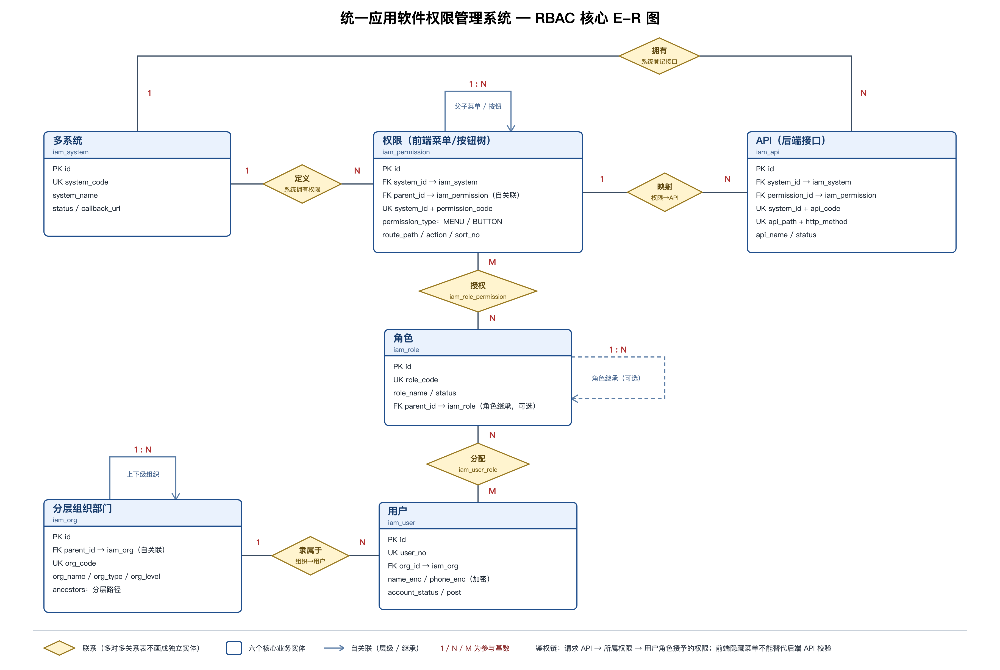

= 统一应用软件权限管理系统需求规格说明书
:doctype: book
:toc: left
:toclevels: 3
:version: 2.0
:revdate: 2026-11-24

[cols="1,3"]
|===
| 项目 | 内容

| 文档名称 | 统一应用软件权限管理系统需求规格说明书（SRS）

| 项目全称 | 统一应用软件权限管理系统（RBAC 统一身份与权限平台）

| 文档版本 | V2.0

| 修订说明 | V1.0（2026-10-20）：首次发布。V1.1（2026-10-26）：合并原 md 版内容（需求条目 FR/NFR、项目范围、用户角色、业务流程、验收用例），新增需求编号体系与分阶段实现状态，新增 RBAC0 授权用例。V2.0（2026-11-24）：按第一轮检查纪要与第二轮双后端（结构化 + 面向对象）实现全面修订：恢复标准 RBAC 术语（User/Role/Permission + 独立 API 实体）、彻底移除通用数据权限残留、补齐 RBAC1 角色继承与课程项目管理系统统一身份接入需求、对齐双后端实现状态并新增需求—测试追溯矩阵

| 编制单位 | 信息中心 / 系统分析组

| 适用阶段 | 需求分析与第二轮检查验收（课程大作业交付物）

| 密级 | 内部
|===

== 1 引言

=== 1.1 编写目的

本文档面向统一应用软件权限管理系统（以下简称"本系统"或"权限平台"）的需求分析阶段，系统定义业务背景、项目范围、用户角色、功能需求、非功能需求、对外接口与验收要点，作为后续概要设计、详细设计、编码实现与测试验收的依据，同时为明确系统边界、组织软件设计、开发与测试提供统一口径。

预期读者：

* 甲方业务代表（信息中心、人力资源部、各分公司综合办公室）；
* 系统分析师、架构师、开发与测试人员；
* 课程指导教师与评审人员；
* 后续承接运维的技术人员。

=== 1.2 项目背景

a. 本系统为通用统一权限管理平台，面向存在多业务子系统、需集中管控身份与权限的各类企业组织。首个接入案例为某市政公司（约 1 万名员工、1 个总公司 + 9 个分公司），其信息中心为开发与管理单位，人力资源部与安全质量部为业务主管部门。
b. 首个接入案例现有 18 套在跑业务系统，"一人一系统一套权限"，存在 1.2.3 节所列痛点。
c. 本系统不重写任何业务系统，而是为各接入企业提供组织级 IAM（身份与访问管理）统一认证与统一授权能力。

==== 1.2.1 首个接入案例的组织规模（参考）

* *员工总数*：10000 人。
* *单位构成*：1 个总公司（约 190 人）+ 9 个分公司（各约 1090 人）：道路工程、桥梁工程、隧道工程（承担海底隧道业务）、轨道交通、管网工程、水务工程、园林绿化、照明工程、市政养护分公司。
* *部门总数*：111 个，呈多级树状：
** 总公司职能部门：综合办公室、党委工作部、人力资源部、财务部、市场经营部、工程技术部、安全质量部、物资设备部、审计监察部、工会办公室等；
** 各分公司下设职能部：综合办公室、财务部、工程技术部、安全质量部、物资设备部、市场经营部；
** 各分公司下设项目经理部：第一～第四项目经理部。
* *与权限强相关的典型岗位*：公司领导（董事长 / 总经理 / 副总经理 / 总工程师 / 总会计师等）、部门经理（部长 / 主任）、项目经理、安全员（约 871 人）、预算员（约 820 人）、质检员（约 751 人）、造价员、施工员、技术员、材料员、资料员、会计、出纳等。
* *现有功能矩阵粗分 5 类角色*：系统管理员、公司领导、部门经理、项目经理、普通员工。

==== 1.2.2 在跑业务软件现状

公司现有 18 套在跑业务系统，本系统不重写业务，而是统一为它们做鉴权：

. OA 协同办公系统
. 企业即时通讯系统
. 企业知识库管理系统
. 人力资源管理系统
. 财务管理系统
. 工程项目管理系统（PMIS）
. 招投标管理系统
. 物资设备管理系统
. 移动巡检 APP
. 工地 AI 视频监控系统
. GIS 地下管线管理系统
. 企业档案管理系统
. 车辆管理系统
. 企业宣传平台
. 安全生产管理系统
. 合同全生命周期管理系统
. 成本管控系统
. 系统管理后台

功能点总数约 *359 个*，现有功能点权限取值集合共 12 种：无、查看、全部、查看/编辑、查看/新增、查看/审批、查看/导出、查看/编辑/审批、查看/新增/编辑、查看/编辑/导出、查看本人、查看/编辑本人。

==== 1.2.3 当前痛点

. *"一人一系统一套权限"*：每套系统各自维护账号与权限，同一员工在 18 套系统中有 18 份账号与权限记录，入职、调岗、离职需逐系统手工处理，易漏改、易残留。
. *权限口径不一致*：同一岗位在不同系统中功能授权不同，缺乏统一角色与功能点定义，越权与权限不足并存。
. *离职账号清理不及时*：离职员工账号可能仍可登录部分系统，存在安全风险；且缺乏统一封存与日志追溯手段。
. *前端隐藏代替后端校验*：部分系统仅靠前端隐藏菜单 / 按钮，直接调用 API 可越权。
. *权限变更生效慢*：权限调整后需重新登录或等待缓存过期，影响业务与安全响应。
. *敏感信息保护不足*：员工姓名、电话号码等明文存储与展示，存在泄露风险。
. *日志留存不合规*：部分系统日志定期删除，无法满足永久保存与审计追溯要求。

本系统的建设目标即针对上述痛点，建立公司级 IAM 平台，实现统一认证、统一授权、前后端双重权限控制、即时生效与永久审计。

=== 1.3 项目范围

==== 1.3.1 本系统做什么（In Scope）

. *统一身份管理*：对接入企业全体员工建立统一账号，覆盖多级树状组织机构（总公司、分公司、部门、项目部等）的组织归属。
. *统一认证（SSO）与多系统隔离*：为权限管理后台（`ADMIN`）及各接入业务系统（当前已接入课程项目管理系统 `course-project-management`）提供统一身份认证与按目标系统隔离的令牌签发/校验能力。
. *统一授权*：以标准 RBAC 模型（课程范围 RBAC0 为基础，第二轮实现双后端 RBAC1 角色继承，并逐步扩展至 RBAC3 约束）统一管理功能权限；不给用户或角色写死管理员标志，管理员能力完全来自角色权限。
. *前后端权限分层建模*：以“多系统 → 前端权限（菜单/按钮树）→ 后端 API（1:N 映射）”结构管理界面可见/可用性与服务端接口访问能力，支持角色—权限操作级别控制。
. *权限全生命周期管理*：人工手动授予与调整、调岗变更、离职封存、权限回收与有效期到期失效。
. *前端控制与后端控制双重校验*：前端按权限控制菜单 / 按钮 / 页面元素的可见与可用；后端拦截器按 API 映射对每次调用做默认拒绝（Fail-Closed）的服务端鉴权。
. *权限即时生效*：后端权限变更后，服务端判定即时生效，前端无需重新登录即可获得最新权限。
. *操作审计日志*：日志永久保存（只追加、不可修改删除），字段至少包含操作时间、操作内容 / 动作、用户名、操作成功与否，支持查询、导出与变更前后快照追溯。
. *敏感信息保护*：员工姓名、电话号码等敏感个人信息加密存储、展示脱敏。

==== 1.3.2 本系统不做什么（Out of Scope）

. *不重写任何业务系统*：各接入业务系统的业务功能、业务流程、业务数据仍由原系统负责，本系统只做统一身份与鉴权。
. *不做通用数据权限*：本系统聚焦功能权限管理，不建立通用数据范围（Data Scope）规则引擎或数据型角色；组织机构层级仅用于员工归属与部门管理范围支撑。
. *不做物理删除*：员工离职采用"封存（禁用）"而非删除账号，日志不做定期删除。
. *不承担人事主数据维护职责*：员工入职、调岗、离职的人事事实由人力资源管理系统产生，本系统接收并执行权限侧处理（人工手动授予 / 调整仍为本系统职责）。
. *不提供统一门户页面聚合*：本系统提供认证与鉴权能力，不负责各接入系统的界面整合与内容聚合。

=== 1.4 定义

==== 1.4.1 编号规则

[cols="1,2,3"]
|===
| 编号格式 | 含义 | 示例

| `FR-NN` | 功能需求条目，按 4.2 节分组，从 01 开始 | `FR-05` 离职封存

| `NFR-NN` | 非功能需求条目（安全、性能、日志、可用性、可扩展性），见第 5、7 章 | `NFR-07` 鉴权延迟

| `IAM-XXX-NNN` | 用例规约（按课程用例格式详述），`XXX` 为用例包：AUTH 统一认证、ORG 组织账号、ROLE 角色权限、AUDIT 审计日志；`NNN` 从 001 开始 | `IAM-ROLE-002` 为用户授予/撤销角色

| `UC-NN` | 验收用例，描述可验证的预期结果，见第 8 章 | `UC-03` 直接调用未授权 API
|===

其他设计文档与代码注释中的"对应 FR-xx / UC-xx"均指本文档中的编号。

==== 1.4.2 需求优先级与实现状态

优先级：*高* = 必须实现，缺失则系统不可验收；*中* = 应实现，影响体验与完整性；*低* = 可延后实现。

课程设计分三次检查逐步实现（见 2.5），每条需求标注当前实现状态：

[cols="1,3"]
|===
| 状态 | 含义

| 已实现 | 结构化后端与面向对象后端均已实现（或已在前后端联调完成）并具备自动化测试覆盖

| 部分实现 | 核心能力已实现，括号内说明尚缺部分及计划/扩展范围

| RBAC3 阶段 | 计划在第三次检查（12 月 22 日～24 日）完善或采用函数式重构的内容

| 扩展 | 课程设计三次检查范围外的扩展需求，时间允许时实现
|===

==== 1.4.3 术语

[cols="1,4"]
|===
| 术语 | 定义

| RBAC | 基于角色的访问控制（Role-Based Access Control）。本系统以 RBAC0 为基础：用户（`User`）—角色（`Role`）—权限（`Permission`）三层授权，用户通过角色获得权限。RBAC1 增加角色继承，RBAC2 增加约束（如角色互斥），RBAC3 = RBAC1 + RBAC2。

| 前端权限（Permission） | 面向管理与界面呈现的菜单 / 按钮权限树节点（`MENU` / `BUTTON`，对应 `iam_permission`），角色直接授予前端权限。在首个接入案例背景资料（1.2.2 节）中沿用客户原称“功能点”。

| 后端 API（API） | 独立建模的服务端 HTTP 接口实体（`iam_api`，含 `api_path + http_method` 与 `system_id + api_code`），与前端权限构成 `1:N` 映射（一个菜单/按钮可对应多个后端 API），作为服务端防绕过鉴权依据。

| 功能权限 | 对"能进哪套系统、哪个菜单、哪个按钮及映射的后端 API、可执行何种操作"的控制，操作取值兼容 12 种集合（见 1.2.2）。

| SSO | 单点登录（Single Sign-On）。用户一次认证后可访问其有权限的各接入业务系统，无需重复登录。

| 令牌（Token） | 本系统签发的 JWT 凭证（携带用户标识、目标系统 `aud`、有效期、签名），业务系统凭令牌向本系统校验身份与权限。

| 封存 | 员工离职后保留账号但禁用（不可登录、不可被分配角色），撤销其全部角色分配并吊销有效令牌，不做物理删除；其历史日志保留可查。

| 脱敏 | 对敏感个人信息（姓名、电话号码等）在展示时按规则遮蔽（如姓名保留姓氏、电话中间四位掩码），存储时加密。

| 互斥 | 两个角色在同一用户上不能同时生效的静态职责分离约束（如会计与出纳）；并发冲突操作需加锁或幂等控制。

| 即时生效 | 后端权限变更后，服务端下一次请求立即按最新授权判定，前端无需重新登录即可同步最新权限集合。

| 最小权限 | 只授予完成工作所必需的最小功能权限，默认拒绝（Fail-Closed）。
|===

=== 1.5 参考资料

. 《面向对象分析与设计 课程成绩计算办法》（V4，课程设计需求与三轮检查计划）。
. 课程讲义《需求分析》《结构化软件设计》《软件体系结构》《面向对象设计》，以及需求规格说明书样例《支付模块需求规格说明书》。
. 《统一应用软件权限管理系统项目背景说明》（甲方口述整理）及第一轮检查纪要。
. 首个接入案例——某市政公司组织与人员数据（10000 人、1 个总公司 + 9 个分公司、111 个部门、岗位人数统计），作为需求验证与规模参考。
. 在跑业务软件清单（18 套系统）及功能权限操作取值集合说明。
. 配套设计文档：《详细设计说明书》（`02_详细设计说明书.adoc`）、《数据库设计说明书》（`03_数据库设计.adoc`）、《API 设计说明书》（`04_API设计说明书.adoc`）、《ER 图实体说明》（`05_ER图实体说明.adoc`）、《前端工程契约与模块设计》（`06_前端契约与模块设计.md`）、《统一身份外部契约》（`07_统一身份外部契约.md`）。

== 2 任务概述

=== 2.1 目标

本系统是连接企业全体员工、各接入业务系统与组织架构的统一权限中枢：建立统一账号与统一组织树，以 RBAC 模型统一管理功能权限，提供 SSO 单点登录与服务端 API 鉴权，实现权限全生命周期（授予 / 调岗 / 回收 / 离职封存）、前后端双重控制、权限变更即时生效、操作日志永久保存、敏感信息加密脱敏。新增业务系统接入只需登记配置、不改核心代码。

=== 2.2 运行环境

* 操作系统与编排：Linux（Ubuntu / CentOS Server），Docker Swarm 集群部署（同时托管权限系统前后端与课程项目管理系统前后端）
* 后端运行环境：JDK 17 或 21、Spring Boot 3.4、Nginx；提供结构化（`structured-backend`）与面向对象 DDD（`oop-backend`）两套等价后端实现，各层统一使用 `CloneFactory` 对象拷贝与 `logback` 日志记录
* 数据库与缓存：MySQL 8.0；Redis（权限版本号缓存、写请求幂等与分布式锁）
* 前端：Vue 3 + TypeScript + Element Plus + Pinia + Vue Router 4
* 规模：支持万级账号、多套接入系统、数百权限节点（首个接入案例：10000 账号、18 套系统、约 359 个功能点）

=== 2.3 条件与限制

a. 人事主数据（入职 / 调岗 / 离职事实）以人力资源管理系统为准，本系统接收事件并执行权限侧处理；人工手动授权 / 调整仍为本系统职责。
b. 本系统不负责 18 套系统的业务流程与界面聚合，只做认证与鉴权。
c. 员工离职采用封存而非物理删除；日志永久保存、不得定期删除。
d. 敏感信息（姓名、电话）必须加密存储、展示脱敏。
e. 课程要求：第一次检查用面向功能（结构化）方式实现 RBAC0；第二、三次检查分别用面向功能和面向对象两种方式实现 RBAC1、RBAC3，第三次部分功能采用函数式设计。

=== 2.4 用户角色与特征

==== 2.4.1 功能角色（对应现有 5 类角色）

[cols="1,2,4"]
|===
| 角色 | 典型人员 | 典型功能权限诉求

| 系统管理员 | 信息中心运维人员 | 维护组织、用户、角色、前端权限、后端 API 及授权关系；处理权限变更与封存；查询导出审计日志（能力来自角色权限，无硬编码管理员标志）

| 公司领导 | 董事长 / 总经理 / 副总经理 / 总工程师 / 总会计师等 | 使用经营、工程、安全、财务等授权功能；执行审批类操作

| 部门经理 | 总公司职能部门部长 / 主任、分公司职能部部长 / 主任 | 管理本部门及下级部门人员权限申请与审批；使用本部门业务功能

| 项目经理 | 第一～第四项目经理部项目经理 | 管理本项目人员；使用现场安全、进度、物资等功能

| 普通员工 | 施工员、技术员、材料员、资料员等 | 使用被授权的系统、菜单、按钮和 API 功能
|===

=== 2.5 分阶段实现范围

需求按课程三次检查逐步落地，每条需求的状态见第 4、5、7、8 章各表的"实现状态"列。

[cols="2,4,3"]
|===
| 阶段 | 实现内容 | 主要需求

| 第一次检查：RBAC0（面向功能，10 月 27 日～29 日） | 账号建立与状态管理（含离职封存）、组织树查询 / 新建 / 移动、角色定义、系统与权限/API 登记、角色—权限授权、用户—角色分配与撤销、账号密码登录与令牌签发 / 校验 / 吊销、后端 API 鉴权与前端权限查询、姓名电话加密存储 | FR-01、FR-02、FR-05、FR-08、FR-09、FR-12、FR-17～FR-19、FR-27、FR-28、FR-32、FR-37～FR-39、FR-48

| 第二次检查：RBAC1（面向功能 + 面向对象双后端，11 月 24 日～26 日） | 双后端等价实现（结构化 + DDD 面向对象）；RBAC1 角色继承（禁止循环、父角色停用截断、继承链权限即时生效）；前端权限树与后端 API 独立建模（1:N 映射与 Fail-Closed 默认拒绝）；彻底移除通用数据权限；接入课程项目管理系统统一身份 8 接口并完成 Docker Swarm 部署；管理后台前端联调与菜单切换日志验证；提前落地部分 RBAC3 能力（角色互斥、审计查询导出、变更快照与并发互斥） | FR-04、FR-09（修改、停用）、FR-13、FR-14、FR-16、FR-17～FR-20、FR-29、FR-31、FR-33、FR-35、FR-36、FR-41、FR-42、FR-44～FR-47

| 第三次检查：RBAC3（面向功能 + 面向对象 + 部分函数式，12 月 22 日～24 日） | 完善 RBAC3 约束与全量前端页面闭环、部分核心规则采用函数式设计重构、性能压测与高负载优化 | FR-14 深化、NFR-06、NFR-07 及函数式重构项

| 扩展（课程范围外） | 跨系统浏览器 SSO 跳转、HR 事件对接、审批流、变更推送、各类导出 | FR-06、FR-11、FR-15、FR-21、FR-30、FR-43、FR-50 等
|===

== 3 数据描述

=== 3.1 领域模型

本系统严格区分**核心概念模型（E-R 图）**与**物理运行支撑/扩展表**（详细字段与约束见《ER 图实体说明》`05_ER图实体说明.adoc` 与《数据库设计说明书》`03_数据库设计.adoc`）：

* *核心业务实体（共 6 个，呈现在核心 E-R 图中）*：
** *RBAC 标准核心（3 个）*：用户（`iam_user`，员工统一账号、所属组织、敏感字段加密、账号状态）、角色（`iam_role`，纯功能角色 `role_type = 'FUNC'`，无写死的管理员标志，支持可选自关联 `parent_id` 实现 RBAC1 角色继承）、前端权限（`iam_permission`，菜单/按钮树 `MENU / BUTTON`，通过 `parent_id` 自关联构成层级）。
** *服务端安全边界（1 个）*：后端 API（`iam_api`，独立建模 HTTP 接口 `api_path + http_method` 与 `system_id + api_code`，通过 `permission_id` 与前端权限构成 `1:N` 映射，防绕过前端直调）。
** *必要业务扩展（2 个）*：多系统（`iam_system`，统一管控管理后台 `ADMIN` 与各接入业务系统，界定权限与 API 的系统归属）、分层组织部门（`iam_org`，因员工超 7000 人而扩展，通过 `parent_id` 自关联与 `ancestors` 路径表达四级树，支撑组织归属与部门管理范围判定）。
* *多对多联系（E-R 图中以菱形联系表达，物理落地为带属性的关系表）*：
** `用户 M:N 角色`（分配，`iam_user_role`，承载有效期 `effective_time / expire_time`、授权人、授权原因、状态与乐观锁版本）。
** `角色 M:N 权限`（授权，`iam_role_permission`，承载操作权限取值 `allowed_action`）。
* *物理支撑与阶段扩展表（不画入核心 E-R 图）*：
** 运行支撑表：令牌表（`iam_token`，支持吊销）、统一日志表（`iam_log`，永久只追加，以 `log_type` 区分普通操作 `ACTION` 与带前后快照的权限变更 `PERMISSION_CHANGE`）。
** RBAC2/RBAC3 扩展约束表：角色互斥表（`iam_role_exclusion`，`CHECK (role_id < excluded_role_id)` 防止对称重复）。
* *裁撤说明*：第一轮的非标准表 `iam_module`、`iam_function_point`、`iam_role_function` 以及通用数据权限表 `iam_data_scope`、`iam_role_data_scope` 已全面移除。

RBAC 核心授权链为：`多系统 (1:N) → 前端权限树 (1:N) → 后端 API`，以及 `用户 (M:N) ↔ 角色（可自关联继承）(M:N) ↔ 前端权限`。角色只授予前端权限、不直接关联 API；服务端鉴权时由命中的后端 API 反查所属前端权限，再校验用户在该系统下的有效权限集合。

.领域模型（RBAC 核心 E-R 图，完整表结构见《数据库设计说明书》第 3 章与《ER 图实体说明》）

== 4 功能需求

=== 4.1 功能划分

参与者与系统边界：

* 外部实体：普通员工（E1）、管理员 / 审批人（E2）、18 套业务系统（E3）、HR 人力资源系统（E4）。
* 系统内用例包：统一认证与令牌（AUTH）、组织与账号管理（ORG）、角色与功能授权（ROLE）、日志审计（AUDIT）。

[cols="1,3,2,2"]
|===
| 用例包 | 包含功能 | 需求条目 | 用例规约

| 统一认证 AUTH | SSO 登录、令牌签发与校验、业务系统鉴权、前端权限查询、前后端双重控制、即时生效 | FR-31～FR-43 | IAM-AUTH-001、IAM-AUTH-002

| 组织账号 ORG | 组织树维护、账号建立、入职 / 调岗 / 离职封存、账号状态管理、敏感信息保护 | FR-01～FR-11、FR-48～FR-50 | IAM-ORG-001

| 角色权限 ROLE | 角色定义与继承、角色互斥、前端权限树与后端 API 映射、角色—权限授权、用户—角色分配与撤销 | FR-12～FR-21、FR-27～FR-30 | IAM-ROLE-001、IAM-ROLE-002、IAM-ROLE-003

| 审计日志 AUDIT | 操作日志记录、日志查询导出、变更快照追溯 | FR-44～FR-47 | IAM-AUDIT-001
|===

=== 4.2 功能需求清单

==== 4.2.1 用户与账号管理

[cols="1,1,5,2"]
|===
| 编号 | 优先级 | 需求 | 实现状态

| FR-01 | 高 | 系统应支持员工统一账号的建立，账号唯一标识员工，关联姓名、电话（加密存储）、所属组织（总公司 / 分公司 / 部门 / 项目经理部）、岗位。 | 已实现

| FR-02 | 高 | 系统应支持账号状态管理：正常、停用、封存（离职）、锁定（异常），状态变更需记录操作日志。 | 已实现

| FR-03 | 高 | 员工入职时，系统应支持由系统管理员人工创建账号并授予初始角色；支持从人力资源管理系统接收人员事件作为触发（人事事实以 HR 系统为准）。 | 部分实现（人工建账号与授角色已实现；HR 事件对接为扩展）

| FR-04 | 高 | 员工调岗时，系统应支持调整其组织归属与岗位，并触发权限复核与变更流程（见 4.4.2）。 | 部分实现（调岗与审计已实现；审批式复核流程未实现）

| FR-05 | 高 | 员工离职时，系统应执行封存：保留账号、禁用登录、撤销全部业务角色分配、吊销令牌、日志保留，不做物理删除（见 4.4.3）。 | 已实现

| FR-06 | 中 | 系统应支持账号批量导入与批量状态变更，操作需二次确认并记录日志。 | 扩展

| FR-07 | 中 | 系统应支持账号与角色的分配关系查询，展示某用户当前全部有效功能权限（含角色继承）。 | 已实现
|===

==== 4.2.2 组织机构管理

[cols="1,1,5,2"]
|===
| 编号 | 优先级 | 需求 | 实现状态

| FR-08 | 高 | 系统应支持多级树状组织管理：总公司→分公司（9 个）→部门（111 个，含总公司职能部门、分公司职能部）→项目经理部（第一～第四项目经理部），通过 `parent_id` 与 `ancestors` 路径支撑部门层级查询与本部门/下级部门范围判定。 | 已实现（双后端支持四级组织树查询、新建、修改、停用与移动）

| FR-09 | 高 | 组织节点应支持新增、修改、停用、移动（调整上级），移动需防成环并级联刷新子树 `ancestors` 路径，且不影响历史日志归属（日志保留原组织快照）。 | 已实现

| FR-11 | 中 | 系统应支持组织树查询与导出，展示各节点人数统计。 | 扩展
|===

[NOTE]
====
原 `FR-10` 与 `FR-22～FR-26` 为早期通用数据权限相关条目，已按第一轮评审意见裁撤（本系统仅实现功能权限），保留既有编号不重排以便设计文档与代码注释稳定追溯。
====

==== 4.2.3 角色管理

[cols="1,1,5,2"]
|===
| 编号 | 优先级 | 需求 | 实现状态

| FR-12 | 高 | 系统应支持角色定义：角色编码、名称、功能角色类型（固定 `FUNC`）、描述、状态；不写死管理员标志字段，管理员能力完全来自角色所授权限。 | 已实现

| FR-13 | 高 | 系统应支持 RBAC1 角色继承：子角色继承父角色的功能权限，可叠加扩展；禁止自继承与循环继承，父角色停用时自动截断该支路继承。 | 已实现（双后端均实现并覆盖单测与黑盒契约测试）

| FR-14 | 高 | 系统应支持角色互斥：互斥角色不能同时授予同一用户（如会计与出纳操作互斥），授予与配置互斥规则时均校验并拒绝冲突。 | 已实现

| FR-15 | 中 | 系统应支持角色复制、角色停用；停用角色不影响已产生的历史日志。 | 部分实现（角色停用已实现；角色复制为扩展）

| FR-16 | 中 | 系统应预置基础功能角色（管理后台角色及课程项目管理系统角色）。 | 已实现（`seed.sql` 与 `identity_course_upgrade.sql` 已预置）
|===

==== 4.2.4 前端权限与后端 API 映射管理

[cols="1,1,5,2"]
|===
| 编号 | 优先级 | 需求 | 实现状态

| FR-17 | 高 | 系统应以“多系统 → 前端权限（菜单/按钮树，`MENU`/`BUTTON`）→ 后端 API”结构管理功能权限，同时支持管理后台（`ADMIN`）与多套业务系统（如 `course-project-management`）接入。 | 已实现（18 套市政案例批量数据导入为扩展）

| FR-18 | 高 | 角色—权限授权的操作取值（`allowed_action`）应支持现有 12 种集合（见 1.2.2）。 | 已实现

| FR-19 | 高 | 系统应独立建模后端 API（`api_path + http_method` 与 `system_id + api_code`），并与前端菜单/按钮权限建立 `1:N` 映射，作为服务端拦截鉴权依据；禁止跨系统映射。 | 已实现

| FR-20 | 中 | 系统应支持角色功能权限的批量授予与撤销，操作记录日志与变更快照。 | 已实现

| FR-21 | 中 | 系统应支持按系统 / 角色 / 用户多维度查询功能权限矩阵并导出。 | 扩展
|===

==== 4.2.5 授权与回收

[cols="1,1,5,2"]
|===
| 编号 | 优先级 | 需求 | 实现状态

| FR-27 | 高 | 系统应支持人工手动授予 / 调整权限：角色—权限授权（`/roles/{roleId}/permissions`）、用户—角色分配（`/roles/{roleId}/assignments`，支持有效期与防越权授予），全部操作留痕。 | 已实现

| FR-28 | 高 | 系统应支持权限回收：撤销用户—角色分配、解除角色—权限授权，回收后服务端鉴权即时生效。 | 已实现

| FR-29 | 高 | 系统应支持 RBAC1 权限继承解析：用户通过角色继承链获得权限，继承链上的权限变更或父角色停用对用户即时生效。 | 已实现（双后端均实现并有领域/应用层测试覆盖）

| FR-30 | 中 | 系统应支持授权申请—审批—执行流程（部门经理 / 项目经理审批，系统管理员执行），审批记录纳入审计日志。 | 扩展
|===

==== 4.2.6 统一认证与对外鉴权

[cols="1,1,5,2"]
|===
| 编号 | 优先级 | 需求 | 实现状态

| FR-31 | 高 | 系统应提供统一登录认证：登录接收用户名、密码及目标系统标识列表 `systems`，校验账号与系统状态后签发绑定目标系统 `aud` 的 JWT，返回用户在该系统的信息与全部有效权限；跨系统按 `systemCode` 隔离。 | 已实现（含管理后台登录与课程系统统一身份 8 接口；浏览器跨系统跳转回跳为扩展）

| FR-32 | 高 | 系统应签发令牌（Token），令牌应包含用户标识、目标系统 `aud`、有效期、签名，支持校验、登出吊销及改密吊销。 | 已实现

| FR-33 | 高 | 系统应向接入业务系统提供统一身份与鉴权接口（参见《统一身份外部契约》`07_统一身份外部契约.md` 的 8 个接口）：支持令牌校验、查询当前用户角色与前端权限、按权限码与 `operationId` 校验 API 权限、分页查询部门及部门用户。 | 已实现（双后端已实现并通过跨后端契约与 CORS 测试）

| FR-34 | 高 | 系统应支持令牌过期与续期策略，令牌吊销后业务系统鉴权应立即失败。 | 部分实现（过期与吊销已实现；自动续期为扩展）

| FR-35 | 中 | 系统应支持业务系统接入登记（系统编码、回调地址、密钥），作为新系统接入的扩展点（当前已接入课程项目管理系统 `course-project-management`）。 | 已实现（支持 `POST /systems` 登记，已提供课程系统初始化脚本）
|===

==== 4.2.7 前端可见 / 可用控制与后端 API 鉴权双重控制

[cols="1,1,5,2"]
|===
| 编号 | 优先级 | 需求 | 实现状态

| FR-36 | 高 | 前端应依据权限控制菜单、按钮、页面元素的可见与可用（enable/disable），无权限元素不展示或置灰；前端缓存权限仅用于界面渲染，操作时仍由后端实时校验。 | 已实现（动态路由、菜单过滤、`v-perm` 指令与后端权限校验已联调，并有前端单测与菜单切换日志验证）

| FR-37 | 高 | 后端应对每个 API 调用做服务端权限校验（Fail-Closed 默认拒绝），不得仅依赖前端隐藏；未登记 API、未映射前端权限或无权限调用一律返回 `403` 并记录日志。 | 已实现

| FR-38 | 高 | 前后端权限判定应使用同一权限数据源，避免口径不一致。 | 已实现

| FR-39 | 中 | 系统应提供前端权限查询接口（`/open/permissions`、`/api/v1/auth/me`），返回当前用户在某系统的菜单 / 按钮权限集合。 | 已实现
|===

==== 4.2.8 权限变更即时生效与并发互斥

[cols="1,1,5,2"]
|===
| 编号 | 优先级 | 需求 | 实现状态

| FR-40 | 高 | 后端权限变更后，前端应即时响应：无需重新登录即生效；服务端通过版本号缓存失效机制确保每次 API 鉴权实时生效。 | 部分实现（后端每次请求实时判定，立即生效；前端按路由切换与定时轮询刷新菜单）

| FR-41 | 高 | 系统应对并发 / 冲突操作加互斥与幂等控制（分布式锁 + `Idempotency-Key` 写请求幂等校验，冲突返回 `409`），保证数据一致性。 | 已实现

| FR-42 | 高 | 权限变更应记录变更前后快照（`before_snapshot` / `after_snapshot`），支持追溯。 | 已实现

| FR-43 | 中 | 系统应支持变更通知：向受影响的业务系统推送权限失效 / 更新事件。 | 扩展
|===

==== 4.2.9 操作审计日志

[cols="1,1,5,2"]
|===
| 编号 | 优先级 | 需求 | 实现状态

| FR-44 | 高 | 系统应记录操作审计日志（`iam_log`），字段至少包含：操作时间、操作内容 / 动作、用户名、操作成功与否；扩展操作对象、来源 IP、所属系统与请求追踪 `X-Request-Id`。 | 已实现

| FR-45 | 高 | 日志应永久保存，不得定期删除；支持按时间、用户名、操作类型、成功与否分页查询。 | 已实现

| FR-46 | 高 | 日志应支持导出（CSV，防公式注入转义），导出操作本身亦记录日志。 | 已实现

| FR-47 | 中 | 日志应防篡改（只追加、不可修改），并支持归档存储与容量规划。 | 部分实现（数据库 `BEFORE UPDATE/DELETE` 触发器阻止修改/删除；归档与容量规划为扩展）
|===

==== 4.2.10 敏感信息加密与脱敏

[cols="1,1,5,2"]
|===
| 编号 | 优先级 | 需求 | 实现状态

| FR-48 | 高 | 员工姓名、电话号码等敏感个人信息应加密存储（如国密 / AES 加密），密钥独立管理。 | 部分实现（AES-256-GCM 加密存储已实现；密钥目前在配置文件中，独立托管为扩展）

| FR-49 | 高 | 敏感信息展示时应脱敏（姓名保留姓氏、电话中间四位掩码），仅授权场景可申请查看明文并记录日志。 | 部分实现（电话已脱敏；普通用户视图返回解密姓名，明文查看由独立权限保护和审计）

| FR-50 | 中 | 敏感信息导出应默认脱敏，导出明文需审批并记录日志。 | 扩展
|===

=== 4.3 用例描述

==== 4.3.1 统一认证登录与令牌签发

[cols="2,2"]
|===
| 用例编号：IAM-AUTH-001
| 用例名称：统一认证登录与签发令牌
| 级别：子功能
| 参与者：普通员工（E1）、接入业务系统（E3，含管理后台 `ADMIN` 与课程项目管理系统）
| 描述：用户携带账号、密码和目标系统标识列表进行统一认证，校验通过后签发带目标系统 `aud`、签名与有效期的 JWT，并返回用户在该系统的信息与有效权限。
| 触发事件：用户登录权限管理后台或任一接入业务系统。
| 主成功场景：
a| 1. 用户提交 `username`、`password` 及非空且不可重复的目标系统标识列表 `systems`。
2. 系统校验目标系统存在且启用、校验账号存在且状态为正常（非停用/封存/锁定）并核对密码。
3. 校验通过后签发 JWT（含用户标识 `sub`、目标系统 `aud`、有效期、签名），写入令牌库 `iam_token`。
4. 返回令牌、用户基本信息及当前系统下的全部有效权限（或由业务系统持令牌调用 `/api/v1/auth/me`、`/open/permissions` 获取）。
| 信息：账号密码、目标系统列表 `systems`、JWT 令牌、用户信息、有效权限集合
| 扩展场景：
a| 1a. 目标系统缺失、重复、不存在或已停用：拒绝登录并提示参数或系统错误。
1b. 账号或密码错误：统一提示"账号或密码错误"，不区分账号是否存在。
1c. 账号已停用/封存/锁定：拒绝登录，记录失败日志。
3a. 令牌过期、登出或改密吊销：业务系统及管理后台后续鉴权立即返回 `401`。
| 其他：全程记录审计日志（时间、用户、目标系统、成功与否）。对应需求：FR-31、FR-32、FR-34；验收用例：UC-02、UC-12。双后端已实现管理后台登录与课程系统统一身份登录契约（`POST /api/v1/auth/login`、`POST /api/v1/auth/logout`）；浏览器跨系统自动回跳为扩展。
|===

==== 4.3.2 服务端 API 鉴权（前后端双重控制）

[cols="2,2"]
|===
| 用例编号：IAM-AUTH-002
| 用例名称：服务端 API 鉴权（前后端双重控制）
| 级别：子功能
| 参与者：权限管理后台及接入业务系统（E3）
| 描述：前端按权限树控制菜单与按钮展示，后端拦截器或对外鉴权接口对每次 API 调用做独立校验，实行 Fail-Closed 默认拒绝，防止绕过前端越权访问。
| 触发事件：HTTP 请求到达管理后台或业务系统后端。
| 主成功场景：
a| 1. 服务端校验 Bearer JWT 有效性、有效期及 `iam_token` 未被吊销。
2. 管理后台拦截器按匹配路由模板与 HTTP 方法查询 `iam_api`，找到其映射的前端权限 `permission_id`（外部课程系统则调用 `GET /api/v1/auth/api-permissions/{operationId}` 按 `api_code` 查询）。
3. 实时计算用户在当前系统下的有效权限集合（含 RBAC1 父角色继承，并按目标系统隔离）。
4. 目标权限在用户有效权限集合中且操作级别覆盖本次请求则放行；否则返回 `403` 无权限。
| 信息：JWT 令牌、目标系统、`api_path + http_method`（或 `operationId`）、所属前端权限
| 扩展场景：
a| 1a. 令牌缺失、无效、过期或已吊销：返回未认证（`401`）。
2a. 请求对应的 API 未在 `iam_api` 中登记，或未映射到任何前端权限：默认拒绝（`403`）。
3a. 用户虽通过其他系统登录或前端绕过界面隐藏直接构造请求：服务端校验不通过，一律拒绝（`403`）。
| 其他：每次鉴权与接口访问均记录日志（成功与否、耗时与 `X-Request-Id`）。对应需求：FR-19、FR-33、FR-36～FR-39；验收用例：UC-01、UC-03、UC-12。双后端均已实现并在启动时通过 `ApiRegistrationAudit` 检查管理端漏登接口。
|===

==== 4.3.3 账号与组织管理、离职封存

[cols="2,2"]
|===
| 用例编号：IAM-ORG-001
| 用例名称：账号全生命周期与离职封存
| 级别：子功能
| 参与者：管理员（E2）、HR 系统（E4）
| 描述：建立统一账号，维护四级组织树；入职授权、调岗变更、离职封存。
| 触发事件：HR 入职/调岗/离职事件，或管理员手工操作。
| 主成功场景：
a| 1. 入职：管理员建账号、授初始角色（或接收 HR 事件触发）。
2. 调岗：调整组织归属与岗位，系统列出与新岗位不符的现有权限，人工回收/授予。
3. 离职：账号置"封存"，禁用登录，撤销全部业务角色分配，吊销令牌。
4. 账号与历史日志保留，不做物理删除。
| 信息：账号、组织、岗位、角色分配、状态
| 扩展场景：
a| 1a. 账号已存在：拒绝创建并提示。
3a. 离职员工尝试登录：拒绝；其历史日志仍可查询。
3b. 已封存账号不可再变更状态或被授权。
| 其他：状态变更与封存均记录前后快照与审计日志。对应需求：FR-01～FR-05；验收用例：UC-02。人工建号、封存、调岗与审计均已实现；HR 事件触发为扩展。
|===

==== 4.3.4 角色定义、功能权限授权与互斥校验

[cols="2,2"]
|===
| 用例编号：IAM-ROLE-001
| 用例名称：角色定义、功能权限授权与互斥校验
| 级别：用户目标
| 参与者：管理员（E2）
| 描述：维护纯功能角色（`role_type = 'FUNC'`），配置角色—前端权限授权及角色互斥规则，并在授权时执行最小权限与互斥校验。
| 触发事件：管理员配置角色、角色权限或互斥规则。
| 主成功场景：
a| 1. 定义角色（编码、名称、描述，可选指定父角色以建立 RBAC1 继承关系，禁止循环）。
2. 为角色授予前端权限（`POST /roles/{roleId}/permissions`，`allowed_action` 取 12 种之一）。
3. 为用户分配角色（`POST /roles/{roleId}/assignments`）；分配时校验互斥规则（如会计与出纳不能同授）与防越权授予（不可授予超出操作者自身范围的权限）。
4. 保存后递增权限版本号使缓存立即失效，记录前后快照与审计日志，服务端下一次请求即时生效。
| 信息：角色、前端权限、操作级别 `allowed_action`、用户—角色分配、互斥对
| 扩展场景：
a| 1a. 角色编码已存在或角色类型非法：拒绝创建。
3a. 触发角色互斥冲突或超出操作者权限范围：拒绝并提示，操作留痕。
3b. 临时分配设置失效时间 `expire_time`：到期后自动失效不再计入有效权限。
3c. 配置新互斥规则时已有用户同时拥有两角色：拒绝建立互斥规则。
| 其他：授权/回收全部记录审计日志与变更快照。对应需求：FR-12～FR-14、FR-17～FR-20、FR-27；验收用例：UC-04、UC-05、UC-09。双后端均已实现。
|===

==== 4.3.5 为用户分配 / 撤销角色（RBAC0）

[cols="2,2"]
|===
| 用例编号：IAM-ROLE-002
| 用例名称：为用户分配 / 撤销角色
| 级别：用户目标
| 参与者：管理员（E2）
| 描述：管理员把角色分配给用户，用户由此获得该角色（及其继承的父角色）所拥有的前端权限；撤销后服务端立即失去对应权限。
| 触发事件：员工入职、岗位职责变化，或管理员调整权限。
| 主成功场景：
a| 1. 系统显示用户及其当前角色分配列表。
2. 管理员选择要分配的角色，可选填失效时间与授权原因，提交。
3. 系统校验用户存在且为正常状态、角色存在且有效、失效时间晚于当前时间、未重复分配、无角色互斥冲突，校验通过后保存分配记录。
4. 用户下一次请求起即拥有该角色的有效权限，无需重新登录。
5. 撤销时，管理员选择用户的某个有效角色撤销，系统将分配记录置为 `REVOKED`，用户下一次请求起失去对应权限。
| 信息：用户、角色、失效时间、授权人、授权原因
| 扩展场景：
a| 3a. 用户已停用 / 封存 / 锁定：拒绝分配。
3b. 角色不存在或已停用：拒绝分配。
3c. 已分配该角色：提示重复分配。
3d. 失效时间不晚于当前时间：提示参数错误。
5a. 用户未被分配该角色：提示分配记录不存在。
5b. 撤销后再次分配：恢复原分配记录为有效。
| 其他：对应需求：FR-03、FR-27、FR-28；验收用例：UC-04。当前接口为 `POST /roles/{roleId}/assignments` 和 `DELETE /roles/{roleId}/assignments/{userId}`。
|===

==== 4.3.6 角色继承管理与权限解析（RBAC1）

[cols="2,2"]
|===
| 用例编号：IAM-ROLE-003
| 用例名称：角色继承管理与权限解析（RBAC1）
| 级别：用户目标
| 参与者：管理员（E2）、鉴权服务
| 描述：通过 `iam_role.parent_id` 建立角色继承层次，子角色自动继承启用状态父角色（及更上级祖先角色）的功能权限，同时防止自继承与循环继承。
| 触发事件：管理员创建/修改角色父级关系，或调整父角色授权/状态。
| 主成功场景：
a| 1. 管理员在创建或更新角色（`POST /roles`、`PUT /roles/{roleId}`）时指定有效的父角色 `parentId`。
2. 系统遍历父角色祖先链，确认目标父角色存在、非自身且不会形成环路后保存继承关系，并使权限缓存失效。
3. 用户被分配子角色后，访问系统时鉴权服务展开其有效角色及全部启用祖先角色集合，合并计算目标系统下的有效前端权限。
4. 管理员为父角色新增或撤销某项权限后，子角色对应的用户下一次请求即时生效，无需重新登录。
| 信息：角色、父角色 `parentId`、角色状态、祖先链、目标系统有效权限集合
| 扩展场景：
a| 2a. 将角色父级设为自身或设为自身的后代角色（如 A → B → A）：拒绝修改，返回继承成环冲突错误（`ROLE_INHERIT_CYCLE`）。
3a. 继承链上某个中间父角色被停用（`DISABLED`）：解析时自动在停用节点处截断，不再向上继承该停用父角色及其祖先的权限。
3b. 继承链上角色跨多个系统拥有权限：按当前请求目标系统（`systemCode`）严格隔离，仅返回目标系统的有效权限。
| 其他：对应需求：FR-13、FR-29；验收用例：UC-11。结构化后端（`RoleService` / `DecisionService`）与面向对象后端（`Role` / `RoleHierarchy` / `PermissionResolver` / `RoleManagementUseCase` / `PermissionAccessUseCase`）均已实现并通过共享黑盒契约测试。
|===

==== 4.3.7 操作审计日志

[cols="2,2"]
|===
| 用例编号：IAM-AUDIT-001
| 用例名称：永久审计日志与查询导出
| 级别：子功能
| 参与者：管理员（E2）
| 描述：记录并留存所有关键操作。
| 触发事件：任何登录、授权、鉴权、封存、导出操作。
| 主成功场景：
a| 1. 记录字段：操作时间、操作内容/动作、用户名、成功与否（扩展：对象、来源 IP、系统）。
2. 日志只追加、不可改、永久保存、不得定期删除。
3. 支持按时间/用户名/操作类型/成功与否查询与 CSV/Excel 导出。
| 信息：时间、动作、用户名、成功与否
| 扩展场景：
a| 3a. 导出明文敏感信息需授权，导出动作本身记录日志。
| 其他：对应需求：FR-44～FR-47；验收用例：UC-06。日志查询、导出和只追加保护已实现。
|===

=== 4.4 业务流程

==== 4.4.1 授权流程

. 需求提出：部门经理 / 项目经理根据岗位职责提出权限申请（系统、前端权限）。
. 审批：按审批链审批（部门经理→系统管理员；涉及敏感权限加签）。
. 校验：系统校验角色互斥、角色继承无环与最小权限。
. 执行：系统管理员人工执行角色—权限授权、用户—角色分配。
. 生效：递增权限版本号使缓存立即失效，记录变更前后快照与审计日志。
. 通知：通知申请人及受影响业务系统。

当前实现：角色继承、角色互斥校验、授予冲突检查、防越权授予和变更快照均已由双后端实现；授权审批流与主动事件推送为扩展。

==== 4.4.2 员工调岗权限变更流程

. 触发：人力资源管理系统产生调岗事件（或系统管理员手工发起）。
. 复核：系统列出该员工现有角色与功能权限，标记与新岗位不符项。
. 调整：调整组织与岗位，回收原岗位角色，分配新岗位角色（人工手动执行）。
. 校验：互斥校验、最小权限校验。
. 生效与留痕：即时生效，记录变更前后快照与审计日志。

==== 4.4.3 员工离职封存流程

. 触发：人力资源管理系统产生离职事件（或系统管理员手工发起）。
. 封存：账号状态置为"封存"，禁用登录。
. 回收：撤销全部用户—角色分配。
. 保留：账号与历史日志保留，不做物理删除；日志可查。
. 校验：吊销该账号全部有效令牌，确认无法登录或访问任何系统。
. 留痕：记录封存操作日志。

当前实现：第 2～6 步及封存审计均已由双后端实现，HR 事件自动触发为扩展。

==== 4.4.4 权限变更后前端即时生效流程

. 系统管理员提交权限变更（角色继承、角色授权、用户角色分配/撤销）并保存。
. 后端更新权限数据并递增权限版本号，权限缓存立即失效。
. 服务端在下一次 API 请求时立即按最新权限判定（零延迟）。
. 前端在路由切换或定时轮询刷新权限查询接口时获得最新权限集合，菜单 / 按钮即时更新，无需重新登录。
. 变更全过程记录审计日志与前后快照。

==== 4.4.5 一次 API 访问的鉴权决策流程

. 用户在前端发起业务请求，携带 Bearer JWT 令牌。
. 服务端校验令牌签名、有效期以及 `iam_token` 未被吊销（失败返回 `401`）。
. 按匹配路由模板 + HTTP 方法查 `iam_api`（或外部系统按 `operationId` 查询 `api_code`），若 API 未登记或未映射前端权限 `permission_id`，默认拒绝（`403`）。
. 校验用户为正常状态 → 取有效用户—角色分配（`ACTIVE` 且在 `[effective_time, expire_time)` 有效期内）→ 过滤停用角色并沿 `parent_id` 展开 RBAC1 启用祖先角色链（遇停用父角色自动截断）→ 汇总角色所授前端权限（仅保留属于当前目标系统且启用状态的权限）→ 校验目标权限存在且 `allowed_action` 覆盖所需操作。
. 校验通过则执行业务并返回；不通过返回 `403`，记录审计日志（含成功与否与 `X-Request-Id`）。
. 全程不得仅依赖前端隐藏；管理员账号亦走完全相同的鉴权链，无任何角色名硬编码后门。

== 5 性能需求

=== 5.1 数据精确度

* 权限判定结果与角色、继承链、前端权限、API 映射及用户角色分配数据强一致。
* 姓名、电话加密存储，展示脱敏规则固定（姓名留姓、电话中间四位掩码）。

=== 5.2 时间特性

[cols="1,1,5,2"]
|===
| 编号 | 优先级 | 需求 | 实现状态

| NFR-06 | 高 | 支持 10000 人规模账号与 18 套系统、约 359 个功能点的权限管理。 | 部分实现（数据模型与索引已按此规模设计，未做压测）

| NFR-07 | 高 | 单次接口鉴权延迟：平均 ≤ 100ms，峰值 ≤ 200ms（以压测为准）。 | 待压测

| NFR-08 | 中 | 权限查询接口应支持缓存，缓存失效策略与即时生效要求协调。 | 已实现（Redis 版本号缓存，写入后递增版本）
|===

* 权限变更后服务端生效：下一次 API 请求即时生效；前端菜单在路由切换或定时轮询周期内同步更新。

=== 5.3 适应性

[cols="1,1,5,2"]
|===
| 编号 | 优先级 | 需求 | 实现状态

| NFR-13 | 高 | 新增业务系统接入应只需：登记系统、维护前端权限树、登记后端 API 并建立 1:N 映射、配置角色权限，无需改动本系统核心代码。 | 已实现

| NFR-14 | 中 | 角色—权限操作取值集合（`allowed_action`）应可扩展，兼容现有 12 种取值。 | 部分实现（12 种取值已实现；新增取值需调整代码与数据库约束）

| NFR-15 | 中 | 组织树、角色模型应支持后续扩展（如增加分公司、扩展角色继承层级与约束规则）。 | 已实现
|===

== 6 运行需求

=== 6.1 软件接口

本系统向权限管理后台及接入业务系统提供以下接口形态（具体协议见《API 设计说明书》`04_API设计说明书.adoc` 与《统一身份外部契约》`07_统一身份外部契约.md`）：

[cols="1,4,2"]
|===
| 接口 | 说明 | 实现状态

| 令牌校验接口 | 输入令牌，输出有效性、用户标识、过期时间；令牌无效 / 吊销返回失败 | 已实现（`GET /auth/validate`）

| 权限查询与鉴权接口 | 返回当前用户在目标系统的角色与前端菜单/按钮权限，并按权限码或 `operationId` 判定 API 权限 | 已实现（`GET /open/permissions`、`GET /api/v1/auth/me`、`GET /api/v1/auth/permissions/{permission}`、`GET /api/v1/auth/api-permissions/{operationId}`）

| 统一认证接口 | 支持携带目标系统标识列表 `systems` 登录并签发带 `aud` 的 JWT，支持登出吊销与部门/用户身份查询 | 已实现课程系统完整 8 接口（`POST /api/v1/auth/login`、`POST /api/v1/auth/logout` 等）；浏览器跨系统跳转回跳为扩展

| 权限变更通知接口 | 权限变更时向业务系统推送失效 / 更新事件（业务系统亦可主动查询） | 扩展

| 接入登记接口 | 业务系统登记系统编码、回调地址、密钥，用于新系统扩展接入 | 已实现（`POST /systems`，响应不泄露密钥）
|===

接口调用均应记录审计日志（调用方、时间、结果与 `X-Request-Id`）。

=== 6.2 故障处理

[cols="1,1,5,2"]
|===
| 编号 | 优先级 | 需求 | 实现状态

| NFR-11 | 高 | 本系统作为公司级 IAM，应具备高可用设计（避免单点），鉴权服务不可用时业务系统应有降级策略（如短时缓存鉴权结果，需评审）。 | 部分实现（已支持 Docker Swarm 集群部署；业务端降级策略为扩展）
|===

* 令牌签名防伪造、防重放；异常调用拒绝并记录。
* 并发 / 冲突操作加互斥锁与幂等键控制，保证授权数据一致与变更快照可追溯（FR-41、FR-42）。

== 7 其它需求

=== 7.1 安全

[cols="1,1,5,2"]
|===
| 编号 | 优先级 | 需求 | 实现状态

| NFR-01 | 高 | 敏感信息加密存储、展示脱敏；密钥独立管理，禁止硬编码。 | 部分实现（同 FR-48、FR-49）

| NFR-02 | 高 | 遵循最小权限原则，默认无权限，授权方可访问；管理员能力同样来自角色权限，无硬编码特权后门。 | 已实现（管理端 API 未登记、未映射或无权限均默认拒绝）

| NFR-03 | 高 | 防越权：后端每个 API 均校验，未登记 API、无前端权限映射或无对应权限时默认拒绝，防止低权限访问高权限功能。 | 已实现

| NFR-04 | 高 | 令牌应签名防伪造，支持吊销；登录与鉴权接口应防重放。 | 已实现（JWT、令牌吊销、OpenAPI HMAC 时间戳与 nonce 防重放）

| NFR-05 | 中 | 管理后台操作应支持二次确认与操作留痕。 | 已实现
|===

=== 7.2 日志永久存储与归档

[cols="1,1,5,2"]
|===
| 编号 | 优先级 | 需求 | 实现状态

| NFR-09 | 高 | 审计日志永久保存，不得定期删除；采用只追加存储。 | 已实现

| NFR-10 | 中 | 日志按容量规划归档，归档后仍可查询导出；归档不改变"永久保存"属性。 | 扩展
|===

=== 7.3 易用性

[cols="1,1,5,2"]
|===
| 编号 | 优先级 | 需求 | 实现状态

| NFR-12 | 中 | 管理界面应易用，权限树与授权配置清晰，操作有明确反馈。 | 已实现（前端模块、反馈与单测均已完成）
|===

== 8 验收要点与测试追溯

=== 8.1 验收要点

[cols="1,3,4,2,2"]
|===
| 编号 | 用例 | 预期结果 | 对应需求 | 实现状态

| UC-01 | 用户登录系统，查看已授权菜单与按钮并尝试越权接口 | 仅显示已授权的菜单和按钮；直接调用未授权接口时后端拒绝（`403`） | FR-17、FR-36、FR-37 | 已实现（双后端 + 前端）

| UC-02 | 离职员工封存后尝试登录任一接入系统 | 封存自动撤销角色分配并吊销令牌，登录被拒，历史操作日志仍可查询 | FR-05、FR-34、FR-45 | 已实现（双后端）

| UC-03 | 普通员工直接调用未授权、未登记或未映射权限的 API（绕过前端） | 后端拦截器默认拒绝（`403`），记录失败日志 | FR-19、FR-37、NFR-03 | 已实现（双后端）

| UC-04 | 管理员分配 / 撤销用户角色权限 | 后端下一次 API 请求立即按最新权限判定（零延迟）；前端无需重新登录即可同步更新菜单与按钮 | FR-27、FR-28、FR-40 | 已实现（双后端 + 前端）

| UC-05 | 同时分配互斥角色（如会计与出纳）或对已有冲突用户建立互斥规则 | 系统拒绝并提示互斥冲突，操作留痕 | FR-14 | 已实现（双后端）

| UC-06 | 查询并导出审计日志 | 可按时间、用户名、操作类型、成功与否查询并导出 CSV（含公式注入转义）；日志只追加不可删改 | FR-44～FR-47 | 已实现（双后端）

| UC-07 | 查看员工姓名与电话 | 密文存储、电话中间四位脱敏；明文查看需独立权限保护并审计留痕 | FR-48、FR-49 | 部分实现（双后端：电话脱敏与独立明文权限审计已实现；普通视图返回解密姓名）

| UC-08 | 新增业务系统接入 | 通过系统登记、前端权限树登记、后端 API 登记与 `1:N` 映射完成接入，无需修改核心代码 | FR-17、FR-19、FR-35、NFR-13 | 已实现（双后端）

| UC-09 | 调整角色—权限授权与操作级别 | 角色权限授予/解除即时生效，未覆盖所需 `allowed_action` 或未授权接口均被后端拒绝 | FR-18、FR-20、FR-27、FR-28 | 已实现（双后端）

| UC-10 | 写请求并发与重复提交控制 | 并发修改同一授权关系由锁与幂等键保护（相同键不同请求体返回 `409`），权限变更前后快照可追溯 | FR-41、FR-42 | 已实现（双后端）

| UC-11 | RBAC1 角色继承配置、防循环校验与继承权限解析 | 子角色自动继承启用祖先角色权限；父角色权限变更即时生效；父角色停用自动截断继承；自继承或环路继承（A→B→A）返回冲突拒绝 | FR-13、FR-29 | 已实现（双后端）

| UC-12 | 课程项目管理系统统一身份登录与系统隔离鉴权 | 登录绑定目标 `systems` 签发含 `aud` 的 JWT；通过 8 个外部契约接口查询用户信息、部门、前端权限与 `operationId` API 权限；不同系统权限严格隔离 | FR-31、FR-33、FR-35 | 已实现（双后端）
|===

=== 8.2 需求与自动化测试追溯矩阵

下表将核心验收用例映射至仓库内真实存在的自动化测试类（含结构化后端、面向对象后端、跨后端黑盒契约测试与前端单元测试），用于第二轮检查对照核验：

[cols="1,2,3,3,2"]
|===
| 验收用例 | 对应需求 | 结构化后端测试（`structured-backend`） | 面向对象后端测试（`oop-backend`） | 契约 / 前端测试

| UC-01、UC-03 | FR-19、FR-36、FR-37、NFR-03 | `ApiControllerTest`（未登记/未映射 API 默认 403、数据权限已下线）、`AuthInterceptorTest`、`ApiServiceTest`、`PermissionServiceTest` | `OopApiSmokeTest`（默认拒绝守卫）、`ApiParityContractTest`（50 端点一致与已下线端点校验）、`PermissionAccessUseCaseTest` | `DualBackendContractTest`、`web/.../menu-permission-guard.spec.ts`、`SidebarMenu.spec.ts`、`PermissionPage.spec.ts`

| UC-02 | FR-01、FR-02、FR-05、FR-32、FR-34 | `AccountServiceTest`（封存撤角色吊令牌、禁用态拒改）、`AuthServiceTest`（封存/停用拒登、同错提示、令牌吊销） | `AuthenticationUseCaseTest`（登录签发、同错提示、改密全吊销）、`OopApiSmokeTest`（改密吊销令牌） | `DualBackendContractTest`（未认证拒访、无令牌校验报错）、`web/.../auth.api.spec.ts`

| UC-04、UC-09 | FR-18、FR-20、FR-27、FR-28、FR-40 | `RoleServiceTest`（分配/撤销/重复/防越权授予/权限授权）、`DecisionServiceTest`（过期忽略、操作级别覆盖、系统过滤） | `RoleManagementUseCaseTest`（分配/过期时间校验）、`RoleGrantTest`（生效/失效/撤销边界）、`PermissionResolverTest` | `DualBackendContractTest`（过期临时分配拒绝）、`web/.../role.api.spec.ts`、`RoleMembersCard.spec.ts`、`RolePermissionBindCard.spec.ts`

| UC-05 | FR-14 | `RoleServiceTest`（`grantRejectsMutuallyExclusiveRole`、`bindExclusionRejectsExistingUsersWithBothRoles`） | `RoleManagementUseCaseTest`、`ApiParityContractTest`（互斥端点契约对齐） | `ApiParityContractTest`（双后端端点一致性）

| UC-06 | FR-44～FR-47 | `LogServiceTest`（同表双类型、时间校验、CSV 公式注入转义）、`ApiControllerTest`（统一日志查询）、`MenuSwitchLoggingTest` | `MenuSwitchLoggingTest`、`JpaAdapterTest` | `DualBackendContractTest`（审计日志分页查询）

| UC-07 | FR-48、FR-49、NFR-01 | `CryptoComponentTest`（密码加盐、AES 加解密、姓名电话脱敏）、`AccountServiceTest`（加密存储、脱敏视图与显式明文视图） | `OopApiSmokeTest`、`ApiParityContractTest` | `DualBackendContractTest`（用户分页）

| UC-08 | FR-08、FR-09、FR-17、FR-35、NFR-13 | `SystemServiceTest`、`PermissionServiceTest`（树节点、1:N 映射、防跨系统映射）、`ApiServiceTest`、`OrganizationServiceTest`（`ancestors` 与防成环移动） | `OrganizationTest`（层级与 `ancestors` 路径）、`OopApiSmokeTest`（组织更新与调岗） | `DualBackendContractTest`（系统/组织/权限树/API 目录）、`web/.../system.api.spec.ts`、`ApiMappingCard.spec.ts`

| UC-10 | FR-41、FR-42 | `RedisIdempotencyStoreTest`（幂等重放与指纹冲突 409）、`ApiControllerTest`（幂等键含调用方指纹）、`RequestIdFilterTest` | `LocalIdempotencyStoreTest`（幂等重放与冲突）、`CodingConventionArchitectureTest`（架构与 `CloneFactory` 规范） | `CloneFactoryMappingTest`（对象拷贝映射校验）

| UC-11 | FR-13、FR-29 | `RoleServiceTest`（`roleHierarchyRejectsCycle`、`updateRoleRejectsInheritanceCycle`）、`DecisionServiceTest`（停用角色不授权限） | `RoleTest`（拒自继承、停用态）、`RoleHierarchyTest`（多级展开、停用截断、防环）、`PermissionResolverTest`（继承权限解析）、`RoleManagementUseCaseTest`（换父防环）、`PermissionAccessUseCaseTest` | `DualBackendContractTest`（`roleInheritanceCycleUsesStableConflictCode`）

| UC-12 | FR-31、FR-33、FR-35 | `IdentityServiceTest`（当前用户、部门分页、`operationId` 鉴权、用户查询）、`IdentityCorsAndContractTest`、`ApiControllerTest`（外部 8 接口契约） | `IdentityCorsAndContractTest`、`OopApiSmokeTest`（真实 HTTP `/auth/me`）、`ApiParityContractTest` | `DualBackendContractTest`（`/auth/me` 与缺失 `operationId` 稳定错误码）
|===

文档结束。
