= 统一应用软件权限管理系统 详细设计说明书
:doctype: book
:toc: left
:toclevels: 3

[cols="1,3"]
|===
| 项目 | 内容

| 文档名称 | 统一应用软件权限管理系统 详细设计说明书

| 项目全称 | 统一应用软件权限管理系统（RBAC 统一身份与权限平台）

| 文档版本 | V3.0

| 修订说明 | V3.0（2026-11-22）：以当前双后端代码为事实源，更新模块、接口、数据表、角色继承/互斥、审计和错误处理描述。API 详细契约以《API 设计说明书》V4.0 和《RBAC 后端 API 使用手册》2.0 为准

| 编制单位 | 信息中心 / 系统架构组

| 上游依据 | 《需求规格说明书》V1.1、《数据库设计说明书》V1.2

| 配套文档 | 《API 设计说明书》（本文档的接口部分）、《数据库设计说明书》（数据部分）、《ER 图实体说明》

| 适用阶段 | 详细设计（第一次检查：RBAC0，面向功能实现）

| 密级 | 内部
|===

== 1 引言

=== 1.1 编写目的

本文档在《需求规格说明书》的基础上，用结构化（面向功能）设计方法给出系统的数据流分析、模块划分、模块结构图和 RBAC0 各模块的详细设计，作为编码、测试和后续两次迭代（RBAC1、RBAC3）的依据。

=== 1.2 范围与标注

文档同时描述两层内容：

* *目标设计*：完整的统一权限平台（SSO、功能权限、审计、变更推送等），对应需求文档中的全部需求；
* *当前实现*：结构化后端与 OOP 后端均覆盖认证、统一身份、账号、组织、角色治理、功能权限目录、审计和开放接口。第 6 章以结构化过程设计为主，OOP 对照见第 8、9 章。

实现状态的标注与《需求规格说明书》1.4.2 相同：*已实现*、*部分实现*、*RBAC1 阶段*、*RBAC3 阶段*、*扩展*。

=== 1.3 设计方法

课程要求第一次检查用*面向功能*的方式实现 RBAC0，第二、三次检查再分别用面向功能和面向对象两种方式实现 RBAC1、RBAC3。本文档按课件《结构化软件设计》的路线进行：

. *需求 → 数据流图*：从用例和需求条目画出 0 级（系统边界）、1 级（主要加工）、2 级（加工分解）数据流图，检查父子图平衡和 DFD 规则（第 4 章）。
. *数据流图 → 模块结构图*：对 2 级图做*事务分析*（P2 按请求类型分派）和*变换分析*（P3 输入→变换→输出），导出调用层次（第 5.3 节）。
. *模块评价*：用课件的内聚、耦合分级审查模块边界（第 5.4 节）。
. *模块详细设计*：对每个 RBAC0 模块给出接口、输入—处理—输出、异常与数据访问（第 6 章）。

选择面向功能的理由与这种方法在本系统中暴露的问题，见第 8 章。

=== 1.4 文档关系

[cols="1,3"]
|===
| 文档 | 与本文档的关系

| 01 需求规格说明书 | 上游依据。本文档引用的 FR / NFR / UC 编号均指该文档

| 03 数据库设计说明书 | 数据存储 D1～D7 对应的表结构、索引、建表脚本

| 04 API 设计说明书 | 本文档第 6 章各模块对外接口的 HTTP 形式（路径、参数、响应、错误码）

| 05 ER 图实体说明 | 实体与业务板块的对照
|===

== 2 设计目标与设计原则

=== 2.1 设计目标

[cols="3,2,2"]
|===
| 目标 | 对应需求 | 当前状态

| 统一身份与统一鉴权：一套平台承载 10000 名员工的统一账号，向 18 套业务系统提供认证与统一授权 | FR-01、FR-31～FR-35、NFR-06 | 课程系统所需 8 个统一身份接口已实现；浏览器 SSO 跳转为扩展

| 功能权限可判定、前后端同源：系统→模块→功能点→操作四级结构，前端权限查询与后端鉴权使用同一判定逻辑 | FR-17～FR-19、FR-36～FR-39 | 已实现

| 变更即时生效：权限变更后无需重新登录 | FR-40、FR-43 | 部分实现（后端实时判定；推送为扩展）

| 审计永久可追溯：日志只追加、永久保存 | FR-44～FR-47、NFR-09 | 已实现（归档为扩展）

| 敏感信息保护：姓名、电话加密存储、展示脱敏 | FR-48～FR-50、NFR-01 | 部分实现

| 可扩展接入：第 19 套系统只需登记与配置 | FR-35、NFR-13 | 已实现
|===

=== 2.2 设计原则

[cols="1,3"]
|===
| 原则 | 在本系统中的落地

| 按功能分解（结构化） | 模块按"系统要做什么"划分：认证、账号、角色、功能权限、授权、鉴权……；每个模块的处理写成"校验 → 处理 → 落库"的线性过程，实体类只承载数据

| 分级实现 RBAC | RBAC0：用户—角色—权限三层绑定（本次实现）；RBAC1 增加角色继承（FR-13）；RBAC2 增加角色互斥等约束（FR-14）；RBAC3 = RBAC1 + RBAC2。角色继承与互斥不属于 RBAC0

| 高内聚低耦合 | 一个 Service 只负责一类业务数据；Service 之间只传简单数据（用户 ID、角色 ID），不传控制标志；横切能力（加密、异常、响应包）集中在独立组件

| 最小权限 / 默认拒绝 | 新用户无角色即无任何功能点（NFR-02）；管理端 API 登记为功能点后，未授权一律 403

| 后端独立鉴权 | 每个请求在拦截器中认证并鉴权，不依赖前端隐藏（FR-37）

| 前后端同源 | 前端权限查询接口与后端鉴权调用同一个 `DecisionService`（FR-38）

| 账号与数据不物理删除 | 封存、回收都改状态，保留历史（FR-05）
|===

== 3 总体结构

=== 3.1 实际分层结构（RBAC0 已实现）

RBAC0 后端是一个 Spring Boot 应用，分为三层加一个公共包，依赖方向自上而下：

----
com.polyauth.structured
├── interfaces        接口层：接收 HTTP 请求、认证鉴权拦截、参数转换
│   ├── admin         管理端 Controller（Auth / User / Role / System / Org / Audit）
│   ├── openapi       开放鉴权接口（OpenApiController）
│   ├── AuthInterceptor  认证与鉴权拦截器
│   └── WebConfig     拦截器注册（除 /auth/login 外全部拦截）
├── application       应用服务层：按功能划分的业务过程（规则写在这里）
│   ├── auth          M01 统一认证：AuthService
│   ├── account       M02 账号管理：AccountService、UserView
│   ├── role          M04 角色管理：RoleService
│   ├── permission    M05 前端权限树：PermissionService；独立 API 目录：ApiService
│   └── role          M07 角色、继承、互斥、用户角色与角色权限：RoleService
│   ├── decision      M08 鉴权决策：DecisionService
│   ├── organization  M03 组织机构：OrganizationService
│   └── log           M09 统一日志
├── infrastructure    基础设施层
│   ├── persistence   JPA 实体（14 个）与 Repository
│   ├── crypto        M11 加密脱敏组件：CryptoComponent
│   └── cache         权限缓存、分布式锁、幂等与防重放
└── common            统一响应 Result / PageResult、错误码 ErrorCode、业务异常与全局异常处理、枚举
----

分层约束：

* `interfaces → application → infrastructure` 单向依赖，`common` 被各层使用；
* Controller 不写业务规则，只做参数接收、调用 Service、包装 `Result`；
* 业务规则全部在 application 层的过程方法中（面向功能的体现），实体类只有字段与 get/set；
* *不设领域层*：领域层是面向对象 / DDD 的做法，在 RBAC1 的面向对象版本中再引入，用于对比两种方法。

=== 3.2 目标部署结构（演进方向）

目标系统按调用频次和安全边界拆分为多个组件，RBAC0 阶段全部合并在一个应用中：

[cols="1,2,1,1"]
|===
| 组件 | 职责 | 对应需求 | 当前状态

| 统一认证服务 | 登录认证、统一身份契约、令牌签发/校验/吊销 | FR-31、FR-32、FR-34 | 8 个外部接口已实现；浏览器跳转和续期为扩展

| 授权决策服务（PDP） | 令牌校验、功能权限查询和功能权限决策；无状态、可水平扩展 | FR-33、FR-37 | 部分实现（在单体应用内）

| 权限管理后台 | 账号、组织、角色、功能权限和授权回收的可视化管理 | FR-01～FR-30 | 部分实现

| 审计服务 | 日志只追加写入、查询、导出、归档 | FR-44～FR-47 | 已实现查询、导出与只追加；归档为扩展

| 通知 / 推送服务 | 变更事件发布、WebSocket 推送、业务系统回调 | FR-40、FR-43 | 扩展

| Redis 集群 | 决策缓存、分布式锁、幂等与防重放 | NFR-08、FR-41 | 已实现

| 业务系统 SDK / 拦截器 | 18 套系统侧集成：令牌透传、调用鉴权接口、本地短缓存降级 | FR-33、NFR-11 | 扩展
|===

拆分的理由见 5.2 节决策 D2、D3。

== 4 数据流分析

=== 4.1 数据流图元素

[cols="1,2,3"]
|===
| 编号 | 名称 | 说明

| E1 | 普通员工 | 登录、查询自己的菜单/按钮权限

| E2 | 管理员 | 系统管理员、部门经理、项目经理等，提交账号、授权、配置、日志查询请求

| E3 | 18 套业务系统 | 携带令牌调用鉴权接口，接收变更回调

| E4 | HR 人力资源系统 | 人事事件源（入职、调岗、离职）

| P1 | 登录认证 | 核对账号密码、签发令牌（M01）

| P2 | 账号与授权管理 | 建立账号、变更账号状态与封存、授予/撤销用户角色、绑定/解绑角色功能点（M02、M07）

| P3 | 鉴权决策 | 令牌认证、账号状态校验、计算功能点集合、生成功能权限判定结果（M01、M08）

| P4 | 日志审计 | 写入与查询审计日志（M09）

| P5 | 变更通知 | 权限变更后使决策缓存失效、推送前端、回调业务系统（M10）

| P6 | 组织与角色维护 | 维护组织树、角色定义、系统/模块/功能点登记（M03、M04、M05、M12）

| D1 | 账号库 | `iam_user`

| D2 | 组织库 | `iam_org`

| D3 | 角色权限库 | `iam_role`、`iam_user_role`、`iam_system`、`iam_permission`、`iam_api`、`iam_role_permission`、`iam_role_exclusion`

| D5 | 令牌库 | `iam_token`

| D6 | 统一日志库 | `iam_log`（`log_type` 区分普通操作与权限变更）

| D7 | 决策缓存 | Redis，不建表；当前已启用版本号缓存
|===

=== 4.2 0 级数据流图（系统边界）

.0 级数据流图
image::数据流图_0级图.png[0级数据流图,width=100%]

0 级图只画系统边界和外部实体。每个外部实体与系统之间的数据流，都在 1 级图中以同名数据流出现：

[cols="1,3,3"]
|===
| 外部实体 | 流入系统 | 流出系统

| E1 普通员工 | 登录凭证、前端权限查询 | 令牌、菜单/按钮权限集合、权限变更推送

| E2 管理员 | 账号/授权指令、组织/角色/功能点配置、日志查询条件 | 操作结果、配置结果、日志查询结果

| E3 业务系统 | 鉴权请求（带令牌） | 鉴权结果/权限集合、变更回调

| E4 HR 系统 | 人事事件 | —
|===

=== 4.3 1 级数据流图（主要加工）

.1 级数据流图
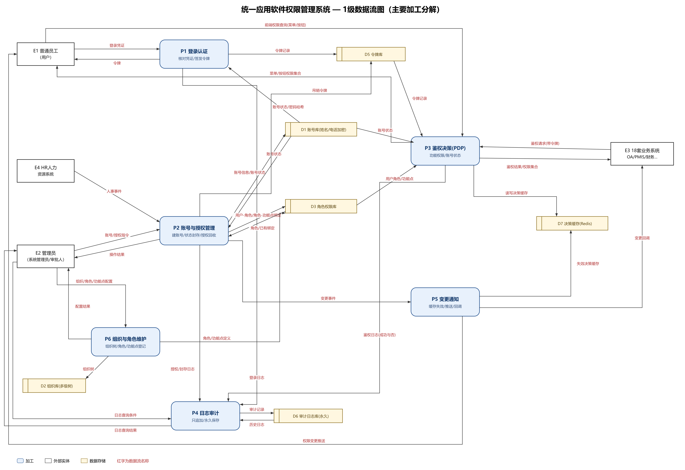

1 级图把系统分解为 P1～P6 六个加工和 D1～D7 七个数据存储。主要数据流：

. *登录*：E1 提交登录凭证 → P1 从 D1 读取账号状态与密码哈希 → 写入 D5 令牌记录 → 向 E1 返回令牌，向 P4 发送登录日志。
. *账号与授权*：E2 提交账号/授权指令、E4 推送人事事件 → P2 读写 D1（账号信息与状态）、读写 D3（用户-角色、角色-功能点绑定）、写 D5（吊销令牌）→ 向 E2 返回操作结果，向 P5 发布变更事件，向 P4 发送授权/封存日志。
. *配置*：E2 提交组织/角色/功能点配置 → P6 写 D2（组织树）、写 D3（角色与功能点定义）→ 返回配置结果。
. *鉴权*：E3 携带令牌发起鉴权请求、E1 发起前端权限查询 → P3 读取 D5 令牌记录、D1 账号状态、D3 用户角色与功能点，读写 D7 决策缓存 → 向 E3 返回鉴权结果，向 E1 返回菜单/按钮权限集合，向 P4 发送鉴权日志。
. *变更通知*：P5 接收变更事件 → 使 D7 中的决策缓存失效 → 回调 E3，向 E1 推送权限变更。
. *审计*：P4 把审计记录写入 D6；E2 提交日志查询条件 → P4 从 D6 读取历史日志 → 返回日志查询结果。

=== 4.4 2 级数据流图

==== 4.4.1 P2 账号与授权管理

.P2 账号与授权管理 2 级数据流图
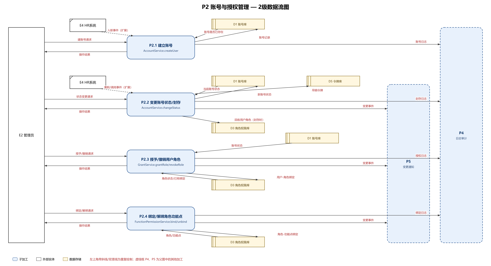

P2 分解为 5 个子加工，每个子加工对应一个 Service 方法：

[cols="1,2,2"]
|===
| 子加工 | 处理 | 实现

| P2.1 建立账号 | 校验账号唯一 → 加密姓名电话、哈希密码 → 写入 D1 | `AccountService.createUser`

| P2.2 变更账号状态/封存 | 读当前状态 → 写新状态 → 非正常状态吊销 D5 中全部令牌 → 封存时回收 D3 中全部用户角色 | `AccountService.changeStatus`

| P2.3 授予/撤销用户角色 | 读 D1 账号状态、D3 角色状态与已有绑定 → 写 D3 用户-角色绑定 | `RoleService.grantRole / revokeRole`

| P2.4 绑定/解绑角色前端权限 | 读 D3 角色与前端权限 → 写 D3 角色-权限绑定 | `RoleService.bindRolePermissions / unbindRolePermissions`

|===

*与父图的平衡核对*：

[cols="2,3"]
|===
| 1 级图中 P2 的数据流 | 2 级图中的对应

| E2 → 账号/授权指令 | 建账号请求 + 状态变更请求 + 授予/撤销请求 + 绑定/解绑请求

| P2 → E2 操作结果 | P2.1～P2.4 的操作结果

| E4 → 人事事件 | 入职事件（→P2.1）+ 离职/调岗事件（→P2.2），均为扩展

| D1 ↔ P2 | 账号是否已存在、当前账号状态、账号状态（读）；账号记录、新账号状态（写）

| D3 ↔ P2 | 角色状态/已有绑定、角色/功能点（读）；回收用户角色、用户-角色绑定、角色-功能点绑定（写）

| P2 → D5 | 吊销令牌（P2.2）

| P2 → P5 / P4 | P2.2～P2.4 的变更事件；P2.1～P2.4 的账号/封存/授权/绑定日志
|===

==== 4.4.2 P3 鉴权决策

.P3 鉴权决策 2 级数据流图
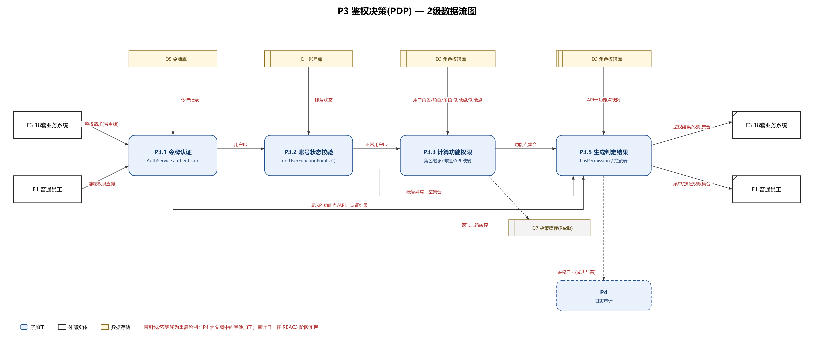

P3 是典型的*变换型*数据流：

* *输入部分*：P3.1 令牌认证（读 D5）把"带令牌的请求"变换为"用户 ID"；P3.2 账号状态校验（读 D1）过滤掉非正常账号；
* *变换中心*：P3.3 计算功能点集合并完成 API 功能权限判定（读 D3）；
* *输出部分*：P3.5 生成判定结果，向 E3 返回鉴权结果、向 E1 返回菜单/按钮权限集合、向 P4 发送鉴权日志。

*与父图的平衡核对*：1 级图中 P3 的输入（E3 鉴权请求、E1 前端权限查询、D5 令牌记录、D1 账号状态、D3 用户角色/功能点、D7 决策缓存）与输出（E3 鉴权结果/权限集合、E1 菜单/按钮权限集合、P4 鉴权日志）在 2 级图中全部出现，没有新增或丢失的外部数据流。子加工之间新增的"用户 ID""正常用户 ID""功能点集合"等是 P3 内部数据流。

=== 4.5 DFD 规则符合性检查

按课件《结构化软件设计》中的 DFD 规则逐条检查（V1.0 中发现的问题已在本版修正）：

[cols="2,2,3"]
|===
| 规则 | 检查结果 | V1.0 问题及修正

| 每个加工有输入也有输出 | 符合 | P4 原先只写不读、只出不入，现拆出"日志查询条件 → P4 → 日志查询结果"

| 外部实体不能直接连数据存储 | 符合 | V1.0 中"日志查询/导出"从 E2 直接指向 D6，现改为经过 P4

| 每个数据存储既有写入也有读出 | 符合 | V1.0 中 D1 账号库没有任何加工写入（建账号、封存都没画），现增加 P2 → D1；D7 只写不读，现改为 P3 读写、P5 失效

| 父子图平衡 | 符合 | V1.0 中 0 级图缺 E1 的权限查询、推送数据流，又多出"系统 → E2 日志查询"，现两图逐条对应（4.2 节）

| 数据流有名称、只描述数据不描述控制 | 符合 | 锁、事务顺序等实现细节不进 DFD，放在第 7 章

| 读写方向正确 | 符合 | V1.0 中多条"读"数据流箭头指向数据存储，现统一为"存储 → 加工"表示读
|===

=== 4.6 数据字典（主要数据流）

[cols="1,3"]
|===
| 数据流 | 组成

| 登录凭证 | 账号（user_no）+ 密码 +［验证码 ID + 验证码］+［客户端 IP］

| 令牌 | JWT = 令牌 ID（jti）+ 用户 ID（sub）+ 账号（userNo）+ 签发方（iss）+ 签发时间（iat）+ 过期时间（exp）+ 签名（HMAC-SHA384）

| 令牌记录 | 令牌 ID + 用户 ID + 系统编码 + 令牌哈希 + 签发时间 + 过期时间 + 是否吊销 + 状态

| 账号/授权指令 | 建账号请求 \| 状态变更请求 \| 授予/撤销请求 \| 绑定/解绑请求

| 建账号请求 | 账号 + 姓名 + 所属组织 +［密码］+［电话］+［岗位］

| 状态变更请求 | 用户 ID + 目标状态（NORMAL/DISABLED/SEALED/LOCKED）+［原因］

| 授予/撤销请求 | 用户 ID + 角色 ID +［失效时间］+［授权人］+［授权原因］

| 绑定/解绑请求 | 角色 ID + 功能点 ID 列表 + 授予的操作（12 种取值之一）

| 鉴权请求 | 令牌 + 用户 ID + 系统编码 + 功能点 ID（或 API 路径模板 + HTTP 方法）

| 功能点集合 | {功能点 ID}

| 鉴权结果 | 是否允许 \| 错误码（401 类：未登录/令牌无效/过期/吊销；403 类：无功能权限）

| 操作结果 | 统一响应包 = 业务码 + 信息 +［数据］+ 时间戳
|===

== 5 模块设计

=== 5.1 模块清单

[cols="1,2,3,2,2"]
|===
| 编号 | 模块 | 职责 | 依赖 | 实现 / 状态

| M01 | 统一认证 | 登录认证、令牌签发/校验/吊销、8 个统一身份接口；（扩展）浏览器跳转、续期 | M11 | `AuthService`、`IdentityAuthController`、`IdentityService`；已实现外部契约

| M02 | 用户与账号管理 | 账号建立、状态管理（正常/停用/封存/锁定）、账号查询；（扩展）批量导入 | M01（吊销令牌）、M07（回收角色）、M11 | `AccountService`；已实现

| M03 | 组织机构管理 | 多级组织树、节点移动、修改和停用 | 无 | `OrganizationService`；已实现（结构化后端）

| M04 | 角色管理 | 角色定义、继承、互斥和状态治理 | 无 | `RoleService`；已实现（结构化后端）

| M05 | 功能权限管理 | 系统、前端权限树、独立 API 目录及 API 权限映射 | M04（角色状态） | `SystemService`、`PermissionService`、`ApiService`；已实现

| M07 | 授权管理 | 用户-角色授予/撤销/全部回收、角色权限绑定、继承和互斥 | M04（角色状态） | `RoleService`；已实现

| M08 | 鉴权决策 | 计算用户在某系统的前端权限集合，按 operationId 判定 API 功能权限 | 无（只读数据） | `DecisionService`、`IdentityService`；已实现

| M09 | 统一日志 | 普通操作与权限变更统一写入 `iam_log`，权限变更保存前后快照 | 无 | `LogService`；已实现，归档为扩展

| M10 | 变更通知与缓存失效 | 变更事件、缓存失效、推送、业务系统回调 | M08 | 缓存失效已实现；推送和回调为扩展

| M11 | 加密脱敏组件 | 字段加解密、密码哈希、检索哈希、展示脱敏 | 无 | `CryptoComponent`；已实现

| M12 | 业务系统接入 | 系统登记（编码、回调地址、密钥）、第 19 套系统扩展接入 | M05 | `SystemService`；已实现基础登记
|===

说明：V1.0 中"M02 依赖 M08（授权）"为笔误，授权模块是 M07，已改正。

=== 5.2 模块划分决策

[cols="1,2,1,4"]
|===
| 编号 | 决策问题 | 结论 | 理由

| D1 | 用户管理与组织管理是否合并？ | 拆分（M02 / M03） | 组织树是稳定主数据，被账号归属和审计快照多方复用；账号生命周期变化频繁且与 HR 事件相关。合并会让组织变更牵动账号写入

| D2 | 认证与鉴权决策是否拆分？ | 拆分（M01 / M08） | 认证回答"你是谁"，决策回答"你能做什么"；决策是业务系统高频调用路径（NFR-07），需要无状态、可单独扩展。RBAC0 中二者已是两个 Service，拦截器分别调用

| D3 | 日志如何建模？ | 普通操作与权限变更统一（M09） | 同一只追加表 `iam_log`，用 `log_type` 区分；权限变更额外保存前后快照

| D5 | 授权管理是否并入角色管理？ | 拆分（M04 / M07） | 角色管理维护"角色是什么"，授权管理维护"谁在何时被授予了什么"；授权是高频写操作，角色定义是低频配置

| D6 | 通知是否并入授权管理？ | 拆分（M07 / M10） | 授权只负责"产生变更"，不关心"如何送达"；新增消费方不改授权代码

| D7 | 加密脱敏是否独立？ | 独立组件（M11） | 被账号、登录、日志导出多处复用；密钥管理需要独立边界。作为本地组件而非服务，避免每次脱敏走网络

| D8 | 接入登记是否并入功能权限？ | 已拆分 | 系统登记由 `SystemService` 负责，前端权限由 `PermissionService` 负责，后端 API 目录由 `ApiService` 负责

| D9 | 令牌是否并入账号表？ | 拆分存储（`iam_token`） | 令牌有独立生命周期（签发、吊销），读写频次远高于账号；令牌只存哈希

| D10 | 鉴权判定是否单独成模块？ | 独立（M08） | 判定规则是最容易变化的设计决策（RBAC1 继承、运行时权限集合与缓存），集中在一个模块里，变化只影响 M08
|===

*原评审结论的处理*（V1.0 第 9 章提出、本版并入）：

[cols="3,1,3"]
|===
| 评审建议 | 处理 | 说明

| M07 只对外暴露 `grant()` / `revoke()` 窄接口，内部封装校验与落库 | 已采用 | `RoleService.grantRole / revokeRole`，调用方不需要知道校验顺序

| M08 判定逻辑集中、前后端复用 | 已采用 | 拦截器、开放接口都调用 `DecisionService`

| M10 拆成缓存失效 / 推送 / 回调三个处理器 | 扩展 | 实现通知时采用

| M09 拆为写模型与读模型 | 已采用 | 写：只追加；读：分页、导出

| "明文查看授权"从 M11 上移到授权判定 | 已采用 | M11 只做加解密与脱敏，明文查看由接口权限独立保护

| 为第 19 套系统定义适配层、为 HR 事件定契约 | 扩展 | 课程范围外
|===

=== 5.3 模块结构图

.RBAC0 后端模块结构图
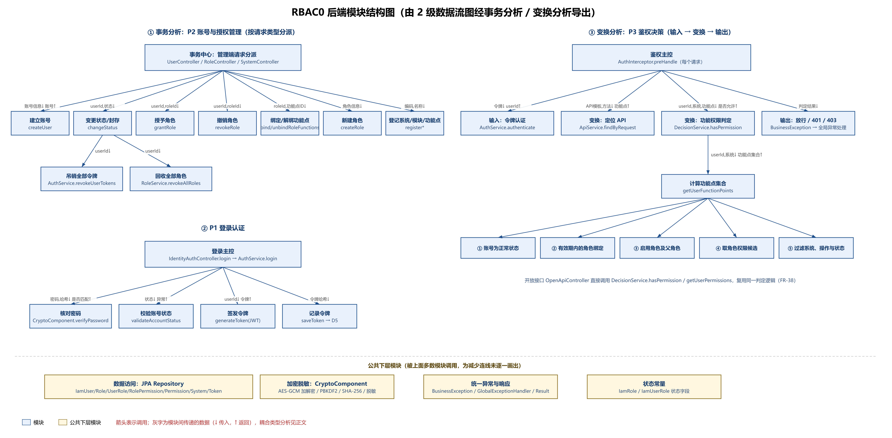

结构图由 2 级数据流图导出：

* *事务分析（P2 → 左侧）*：P2 的输入是多种类型的管理请求，属于事务型数据流。事务中心是管理端 Controller（Spring MVC 按 URL 分派），每种请求对应一个事务模块：`createUser`、`changeStatus`、`grantRole`、`revokeRole`、`bind/unbindRoleFunctions`、`createRole`、`register*`。`changeStatus` 在封存时再调用 `revokeUserTokens` 和 `revokeAllRoles`。
* *变换分析（P3 → 右侧）*：P3 是"输入 → 变换 → 输出"的变换型数据流。主控模块是拦截器 `preHandle`：输入分支 `authenticate`（令牌 → 用户 ID），变换分支 `findByApi`（API 模板 → 功能点）与 `hasPermission`（用户、系统、功能点 → 是否允许），输出分支为放行或抛出 401/403。`hasPermission` 下层的 `getUserFunctionPoints` 按 ①～⑤ 五步计算功能点集合，对应 2 级图的 P3.2、P3.3。
* *P1 登录认证*：登录主控 `AuthService.login` 依次调用核对密码、校验账号状态、签发令牌、记录令牌。
* *公共下层模块*：数据访问（JPA Repository）、加密脱敏、统一异常与响应、状态常量被多数模块调用，图中只在底部列出。

=== 5.4 内聚与耦合分析（按 RBAC0 实际代码）

==== 5.4.1 模块内聚

[cols="1,1,3"]
|===
| 模块 | 内聚等级 | 理由

| M01 `AuthService` | 功能内聚 | 登录、登出、令牌认证、吊销都围绕"令牌"这一件事；`login` 内部是顺序内聚（核对密码的结果是签发令牌的前提）

| M02 `AccountService` | 通信内聚 | 建账号、查询、状态变更、视图转换都操作同一个"账号"数据

| M04 `RoleService` | 通信内聚 | 围绕"角色"数据；互斥相关方法尚未实现

| M05 `PermissionService`、`ApiService` | 功能内聚 | 前端权限树与后端 API 目录独立建模，并通过 `permission_id` 映射

| M07 `RoleService` | 功能内聚 | 负责角色生命周期、用户角色、角色权限、继承和互斥

| M08 `DecisionService` | 功能内聚 | 只做一件事：计算并判定功能权限；`getUserFunctionPoints` 内部五步为顺序内聚

| M11 `CryptoComponent` | 功能内聚 | 只负责密码学相关处理

| `AuthInterceptor` | 顺序内聚 | 认证的输出（用户 ID）是鉴权的输入
|===

==== 5.4.2 模块间耦合

[cols="2,1,3"]
|===
| 交互关系 | 耦合等级 | 说明

| `AccountService` → `AuthService.revokeUserTokens(userId)` | 数据耦合 | 只传用户 ID

| `AccountService` → `RoleService.revokeAllRoles(userId)` | 数据耦合 | 只传用户 ID

| `AuthInterceptor` → `AuthService.authenticate(token)` | 数据耦合 | 传令牌字符串、返回用户 ID

| `AuthInterceptor` → `DecisionService.hasPermission(userId, systemCode, functionPointId)` | 数据耦合 | 只传三个简单值、返回布尔

| `AuthInterceptor` → `ApiService.findByRequest` | 标记耦合 | 返回 API 实体，拦截器读取权限 ID 和名称

| Controller → 前端（返回 `RoleVO`、`UserRoleVO`、`SystemVO`） | 数据耦合 | Controller 已通过 VO 隔离 JPA 实体，前端不依赖表结构

| 各 Service 共用 Repository 与数据库表 | 公共耦合（数据库） | 例如 `RoleService` 与 `DecisionService` 都读写 `iam_user_role`；靠表结构与状态常量约定一致

| `RoleService`、`DecisionService` 等使用实体状态常量 | 数据耦合（常量） | 状态码集中定义，避免各自写死字符串
|===

结论：Service 之间的调用都是数据耦合，没有控制耦合（不传 `isXxx` 这类控制标志）。Controller 通过 VO 返回数据；多个 Service 共用数据库表时仍存在公共耦合，见第 8 章。

== 6 RBAC0 模块详细设计

本章各模块的 HTTP 接口形式见《API 设计说明书》，表结构见《数据库设计说明书》第 3 章。

=== 6.1 M01 统一认证（AuthService / AuthInterceptor）

*职责*：账号密码登录、签发与记录令牌、令牌认证、登出与吊销；拦截每个请求完成认证与鉴权。

*对外接口*

[cols="2,2,2,1"]
|===
| 方法 | 输入 | 输出 | 需求

| `login(LoginRequest)` | 账号、密码、［客户端 IP］ | `LoginResponse`（令牌、类型、有效期、用户 ID、姓名、账号状态） | FR-31、FR-32

| `logout(accessToken)` | 令牌 | 无 | FR-32

| `authenticate(token)` | 令牌 | 用户 ID | FR-32、FR-34

| `validateToken(token)` | 令牌 | 是否有效 | FR-32

| `revokeUserTokens(userId)` | 用户 ID | 无 | FR-05、FR-34
|===

*处理流程：login*

. 校验账号、密码非空，否则 `PARAM_MISSING`。
. 按账号查 D1，过滤已删除账号，用 PBKDF2 核对密码；账号不存在与密码错误返回同一错误 `UNAUTHENTICATED`"账号或密码错误"，防止账号枚举。
. 校验账号状态：`SEALED` → `ACCOUNT_SEALED`；非 `NORMAL` → `ACCOUNT_DISABLED`。
. 签发 JWT（HS384，2 小时），载荷为令牌 ID、用户 ID、账号、签发方、签发与过期时间。
. 把令牌*哈希*写入 D5（不存明文），记录客户端 IP；更新最近登录时间。
. 返回令牌与解密后的姓名。

*处理流程：authenticate*

. 校验签名、签发方、有效期：过期 → `TOKEN_EXPIRED`；格式或签名错误 → `TOKEN_INVALID`。
. 按令牌哈希查 D5：查不到 → `TOKEN_INVALID`；已吊销 → `TOKEN_REVOKED`。
. 返回用户 ID。

*处理流程：AuthInterceptor.preHandle*（除 `POST /auth/login` 外的每个请求）

. 取 `Authorization: Bearer <令牌>`，缺失 → `UNAUTHENTICATED`。
. 调用 `authenticate` 得到用户 ID，存入请求属性。
. 取 Spring MVC 匹配到的映射模板（如 `/users/{userId}`）与 HTTP 方法，调用 `findByRequest` 定位 API 及其前端权限映射。
. 调用 `findByRequest` 定位 API。查不到、未映射前端权限或用户无权限均返回 `NO_FUNCTION_PERM`（403），实现默认拒绝。

*数据访问*：读 D1（`iam_user`）；读写 D5（`iam_token`）。

=== 6.2 M02 用户与账号管理（AccountService）

*职责*：建立账号、查询账号、变更账号状态与离职封存、把实体转为安全视图。

*对外接口*

[cols="2,2,2,1"]
|===
| 方法 | 输入 | 输出 | 需求

| `createUser(userNo, password, realName, phone, orgId, post)` | 账号、［密码］、姓名、［电话］、组织、［岗位］ | 账号实体 | FR-01、FR-03、FR-48

| `listUsers(pageable, orgId, accountStatus)` | 分页、［组织］、［状态］ | 账号分页 | FR-07

| `getUser(userId)` | 用户 ID | 账号实体 | FR-07

| `changeStatus(userId, targetStatus, reason)` | 用户 ID、目标状态、［原因］ | 账号实体 | FR-02、FR-05

| `toView(user)` | 账号实体 | `UserView`（姓名解密、电话脱敏） | FR-49
|===

*处理流程：createUser*

. 按账号查重，已存在 → `RESOURCE_DUPLICATE`。
. 未给密码时使用初始密码（配置项 `iam.default-password`）；密码做 PBKDF2 加盐哈希。
. 姓名、电话用 AES-256-GCM 加密，另存检索哈希；电话为空时不加密。
. 状态置 `NORMAL`、软删除标记置 0，写入 D1。

*处理流程：changeStatus*

. 校验目标状态是 `NORMAL / DISABLED / SEALED / LOCKED` 之一，否则参数错误（400）。
. 查账号，不存在 → `RESOURCE_NOT_FOUND`；已封存 → `USER_ALREADY_SEALED`（封存不可逆）。
. 更新状态与修改时间。
. 目标状态不是 `NORMAL`：调用 M01 吊销该用户全部令牌（下一次请求即 401）。
. 目标状态是 `SEALED`：记录离职时间，调用 M07 回收全部有效角色。账号本身不删除。

*数据访问*：读写 D1；经 M01 写 D5；经 M07 写 D3（`iam_user_role`）。

=== 6.3 M04 角色管理（RoleService）

*职责*：角色定义、查询、修改、继承、互斥，以及用户角色和角色前端权限分配。继承使用 `parent_id`，互斥使用 `iam_role_exclusion`。

[cols="2,2,2,1"]
|===
| 方法 | 输入 | 输出 | 需求

| `createRole(roleCode, roleName, roleType, description)` | 编码、名称、类型（FUNC/DATA）、［描述］ | 角色实体 | FR-12

| `getRole(roleId)` | 角色 ID | 角色实体 | FR-12

| `listRoles()` | 无 | 未删除的角色列表 | FR-12
|===

*处理流程：createRole*：校验角色类型合法（否则 400）→ 编码查重（`RESOURCE_DUPLICATE`）→ 状态置 `ACTIVE` 写入 D3（`iam_role`）。

=== 6.4 M05 前端权限与 API 目录（PermissionService、ApiService）

*职责*：登记系统、前端菜单/按钮权限树和独立后端 API；维护 API 到前端权限的映射；按路径和方法查找 API 供拦截器默认拒绝判定。

[cols="2,2,2,1"]
|===
| 方法 | 输入 | 输出 | 需求

| `registerSystem(systemCode, systemName, description)` | 系统编码、名称 | 系统实体 | FR-35、NFR-13

| `registerModule(systemId, moduleCode, moduleName, sortNo)` | 系统 ID、模块编码、名称、［排序］ | 模块实体 | FR-17

| `registerFunctionPoint(moduleId, pointCode, pointName, action, apiPath, apiMethod)` | 模块 ID、编码、名称、操作取值、［API 模板、方法］ | 功能点实体 | FR-17～FR-19

| `bindRoleFunctions(roleId, functionPointIds, allowedAction, createdBy)` | 角色 ID、功能点 ID 列表、授予的操作 | 无 | FR-27

| `unbindRoleFunctions(roleId, functionPointIds)` | 角色 ID、功能点 ID 列表 | 无 | FR-28

| `getRoleFunctions(roleId)` | 角色 ID | 绑定列表 | FR-07

| `findByApi(apiPath, apiMethod)` | API 模板、HTTP 方法 | 功能点（可能为空） | FR-19、FR-37

| `listSystems()` | 无 | 系统列表 | FR-35
|===

*处理流程：registerFunctionPoint*：校验模块存在（`RESOURCE_NOT_FOUND`）→ 校验操作取值为 12 种之一（400）→ HTTP 方法转大写，API 模板 + 方法已登记 → `RESOURCE_DUPLICATE` → 写入 D3。`apiPath` 必须写 Controller 的映射模板（如 `/users/{userId}`），拦截器按模板精确匹配。

*处理流程：bindRolePermissions*：校验角色存在且为 `ACTIVE` → 校验操作取值 → 校验前端权限存在 → 已绑定的跳过 → 写入 D3（`iam_role_permission`）并记录权限变更快照。

=== 6.5 M07 授权管理（RoleService）

*职责*：用户-角色的授予、撤销、全部回收与查询。这是 RBAC0"用户—角色"关系的唯一写入口。

[cols="2,2,2,1"]
|===
| 方法 | 输入 | 输出 | 需求

| `grantRole(userId, roleId, expireTime, grantBy, grantReason)` | 用户 ID、角色 ID、［失效时间、授权人、原因］ | 绑定实体 | FR-27

| `grantRoles(userId, roleIds, ...)` | 用户 ID、角色 ID 列表 | 无（一个事务，任一失败整体回滚） | FR-20

| `revokeRole(userId, roleId)` | 用户 ID、角色 ID | 无 | FR-28

| `revokeAllRoles(userId)` | 用户 ID | 无 | FR-05

| `getUserRoles(userId)` | 用户 ID | 该用户全部绑定（含已回收） | FR-07
|===

*处理流程：grantRole*

. 用户存在且未删除（`RESOURCE_NOT_FOUND`），状态为 `NORMAL`（否则 `TARGET_USER_ABNORMAL`，3010。这里校验的是被授权的用户，不能用 2006，否则前端会把操作人登出）。
. 角色存在且未删除（`RESOURCE_NOT_FOUND`），状态为 `ACTIVE`（否则 `PARAM_INVALID`）。
. 失效时间不为空时必须晚于当前时间（`PARAM_INVALID`）。
. 查该用户与该角色的绑定：已是 `ACTIVE` → `GRANT_DUPLICATE`；已回收 → 复用原记录；没有 → 新建。
. 写入生效时间、失效时间、授权人、原因，状态置 `ACTIVE`。

同一用户同一角色只保留一行，由唯一约束 `uk_user_role(user_id, role_id)` 保证；并发重复授予时数据库拒绝第二条。角色互斥校验（FR-14）已插入角色有效性与重复授权判断之间。

*处理流程：revokeRole*：查有效绑定，不存在 → `RESOURCE_NOT_FOUND`"用户未被授予该角色"→ 状态置 `REVOKED`（不删除记录）。

=== 6.6 M08 鉴权决策（DecisionService）

*职责*：计算用户在某系统下被授予的功能点集合，并据此做单点或批量判定。拦截器、开放接口、前端权限查询都调用本模块（FR-38）。

[cols="2,2,2,1"]
|===
| 方法 | 输入 | 输出 | 需求

| `getUserFunctionPoints(userId, systemCode)` | 用户 ID、系统编码 | 功能点 ID 集合 | FR-33、FR-39

| `hasPermission(userId, systemCode, functionPointId)` | 用户 ID、系统编码、功能点 ID | 是否允许 | FR-37

| `checkPermissions(userId, systemCode, functionPointIds)` | 用户 ID、系统编码、功能点 ID 列表 | 每个功能点是否允许（只计算一次集合） | FR-33
|===

*处理流程：getUserFunctionPoints*（RBAC0 判定规则）

. 用户存在、未删除、状态为 `NORMAL`，否则返回空集合。
. 取该用户状态为 `ACTIVE` 的用户-角色绑定，只保留在有效期内的（生效时间不晚于现在、失效时间为空或晚于现在）。
. 过滤掉已删除或状态不是 `ACTIVE` 的角色；没有有效角色则返回空集合。
. 取这些角色（含父角色）的角色权限候选，过滤未删除、启用且属于目标系统的权限。
. 按授予操作是否覆盖请求操作做最后过滤，聚合去重后返回权限 ID 集合。

判定语义：`允许 = 令牌有效 ∧ 账号正常 ∧ 功能点 ∈ 集合 ∧ 授予操作覆盖所需操作`。目标数据另由 `DataPermissionService` 联合判定（见 7.2）。

*数据访问*：只读 D1、D3（`iam_user`、`iam_user_role`、`iam_role`、`iam_role_permission`、`iam_permission`、`iam_api`、`iam_system`）。

=== 6.7 M11 加密脱敏组件（CryptoComponent）

[cols="2,3"]
|===
| 方法 | 说明

| `encrypt / decrypt` | AES-256-GCM，随机 12 字节 IV，密文格式 `Base64(IV + 密文 + Tag)`

| `hashPassword / verifyPassword` | PBKDF2-HMAC-SHA256，16 字节随机盐，65536 次迭代，格式 `Base64(盐):Base64(哈希)`；校验用常量时间比较

| `hash` | 检索哈希：SHA-256(原文 + 密钥)，用于姓名、电话、令牌的等值匹配

| `maskName / maskPhone` | 姓名保留首字（`张*`），电话保留前三后四（`138****5678`）
|===

密钥读取自 `application.yml` 的 `crypto.aes-key`，部署时必须用环境变量覆盖（FR-48 中"密钥独立管理"为扩展）。

=== 6.8 公共：统一响应与异常处理

* 所有接口返回 `Result{code, message, data, timestamp}`，成功时 `code = 0`；分页数据为 `PageResult{total, page, pageSize, list}`。
* 业务规则违反统一抛出 `BusinessException(ErrorCode)`，由 `GlobalExceptionHandler` 转换为对应 HTTP 状态码与业务码（单一出口，Service 中不写 try-catch）。
* 参数缺失、类型错误、枚举取值非法、请求体无法解析 → 400；未知路径 → 404；其他未预期异常 → 500 并记录错误日志。
* 错误码表见《API 设计说明书》1.4 节。

=== 6.9 M03 组织机构管理（OrganizationService）

*职责*：维护总公司→分公司→部门→项目经理部四级组织树。新建账号必须选择所属组织，组织树同时为审计快照提供稳定的归属信息。

[cols="2,2,2,1"]
|===
| 方法 | 输入 | 输出 | 需求

| `createOrg(orgCode, orgName, orgType, orgLevel, parentId, sortNo)` | 编码、名称、类型（HQ/BRANCH/DEPT/PROJECT）、层级、［上级、排序］ | 组织实体 | FR-08、FR-09

| `getOrgTree(rootId)` | ［根节点 ID］ | 不传：顶层节点；传：该节点及全部下级的扁平列表 | FR-08

| `getChildren(parentId)` | 上级 ID | 直接下级列表 | FR-08

| `getOrg(orgId)` | 组织 ID | 组织实体 | FR-08

| `moveOrg(orgId, newParentId)` | 组织 ID、新上级 ID | 组织实体 | FR-09
|===

*祖先路径*：`ancestors` 存"0,根ID,…,父ID"，根节点为 `0`。子树查询按"本节点路径"前缀匹配，并要求路径等于前缀或以"前缀,"开头，避免 `0,1` 误匹配 `0,12`。

*处理流程：createOrg*：类型合法（否则 400）且层级与类型一致（HQ=1 … PROJECT=4，否则 `PARAM_INVALID`）→ 编码查重（`RESOURCE_DUPLICATE`）→ 有上级时上级必须存在（`RESOURCE_NOT_FOUND`）且层级更高（`PARAM_INVALID`）→ 祖先路径 = 上级路径 + 上级 ID → 写入 D2。

*处理流程：moveOrg*：节点与新上级都存在 → 新上级不能是自己或自己的下级（成环，`ORG_MOVE_INVALID`）→ 新上级层级必须更高（跨级，`ORG_MOVE_INVALID`）→ 更新本节点的上级与祖先路径 → 把全部下级祖先路径中的旧前缀替换为新前缀，在同一事务中保存。

== 7 关键处理流程

=== 7.1 一次管理端请求的处理顺序

. 请求到达 `/api/v1/...`，`WebConfig` 注册的拦截器先执行（登录接口除外）。
. `AuthInterceptor` 认证令牌 → 定位功能点 → 判定权限（6.1）。
. 通过后进入 Controller，Controller 接收参数并调用 Service。
. Service 按"校验 → 处理 → 落库"执行，写操作在 `@Transactional` 事务中完成。
. Controller 用 `Result.success(...)` 包装返回；任一步抛出 `BusinessException` 则由全局异常处理器返回错误响应。

=== 7.2 鉴权决策流程（PDP）

----
输入：令牌、系统编码、功能点（或 API 模板 + 方法）、［目标数据］
  ├─① 令牌校验：签名有效？未过期？未吊销？      ──否──▶ 401（TOKEN_INVALID / EXPIRED / REVOKED）
  ├─② 账号状态：状态 = NORMAL？                  ──否──▶ 功能点集合为空 → 403
  ├─③ 功能权限：功能点 ∈ 用户经角色获得的集合？   ──否──▶ 403（NO_FUNCTION_PERM）
  ├─④ 操作取值：授予的操作覆盖本次请求所需操作？ （已实现）
  └─⑤ 全部通过 ──▶ 放行
----

当前结构化实现包含第 ①②③③′④ 步，判定语义为 `令牌有效 ∧ 账号正常 ∧ 功能点允许 ∧ 操作覆盖 ∧ 数据在范围内`。第 ③ 步计算功能点集合时已展开父角色（角色继承）。

=== 7.3 权限变更即时生效

* *当前实现*：Redis 权限快照缓存带版本号；授权、撤销、绑定和解绑后递增版本号使旧缓存失效。停用、封存时同步吊销令牌，用户下一次请求即 401。前端每 60 秒轮询权限集合，并在每次菜单切换时调用后端权限校验接口。
* *扩展*：通知服务通过 WebSocket 推送"权限已变更"，并回调业务系统（FR-43）。

=== 7.4 并发与一致性

* *当前实现*：写操作在单个数据库事务中完成；唯一约束 `uk_user_role`、`uk_role_permission`、`uk_api_code` 等由数据库兜底；`grantRoles` 批量授予任一失败整体回滚。
* *并发控制*：授权、回收、封存和角色治理以用户或角色为粒度加 Redis 分布式锁，锁内校验角色互斥（FR-14、FR-41）；权限变更写入前后快照（FR-42）。

== 8 设计评价与存在的问题

=== 8.1 为什么第一次检查采用面向功能的设计

* RBAC0 的业务以"增删改查 + 一条判定规则"为主，按功能分解直观，DFD 中的加工与 Service 方法一一对应，便于从需求追踪到代码。
* 每个处理过程是线性步骤，便于逐步写单元测试。结构化后端当前有 109 项测试通过；OOP 后端 38 项测试通过。
* 面向对象版本已作为独立 `oop-backend` 模块实现相同 50 个功能权限端点，可与结构化版本对照。

=== 8.2 存在的问题

. *同一业务规则散落多处*："账号为正常状态"在 `AuthService.validateAccountStatus`、`RoleService.grantRole`、`DecisionService` 中的判定分别出现；规则变化时需要同步审查多个调用点，这是当前结构化实现仍需收敛的变更放大风险。
. *数据与处理分离*：实体类只有字段，"角色是否有效""绑定是否在有效期内"这类判断写在各个 Service 里，没有统一的归属。
. *判定链较长*：一次判定需要读取用户、角色继承链和角色权限；当前已用 Redis 快照缓存，但仍需在生产数据量下压测 NFR-07。
. *OOP 进程内基础设施*：OOP 当前部署单副本，幂等和 nonce 防重放使用进程内存储；若未来扩展为多副本，必须迁移到 Redis 等共享存储。
. *变更通知未实现*：权限缓存失效已经实现，但 WebSocket 推送和业务系统回调仍为扩展。
. *日志归档未实现*：统一日志已经支持普通操作与权限变更快照、查询和导出，但容量归档策略仍需后续完善。

=== 8.3 与面向对象版本的对照

`oop-backend` 对全部业务能力使用领域对象与端口隔离，当前对照如下：

* 把规则放到拥有数据的对象上（GRASP 信息专家）：`UserAccount.canAuthenticate()`、`RoleGrant.isEffective(now)`、`Role.update(...)`；
* 角色继承由 `RoleHierarchy` 纯函数展开，权限集合由 `PermissionResolver` 过滤，应用用例只编排读取与计算；
* `application` 只依赖领域对象、领域仓储接口和应用端口，JPA、JWT、AES 与 Redis 等实现留在 `infrastructure`；
* 结构化版本保留线性 Service 过程，用于对照规则散落、实体贫血与依赖方向差异。

=== 8.4 V1.0 遗留问题的处理

[cols="3,1,2"]
|===
| V1.0 第 9.5 节指出的问题 | 状态 | 处理

| 只有模块清单，没有结构图 | 已解决 | 5.3 节模块结构图

| DFD 中 D7 语义含糊、决策缓存未登记、P4 黑洞/奇迹混合、P1↔P3 经 D5 的读写未画 | 已解决 | 第 4 章重画并逐条检查

| M08 与 M10 共享 Redis 的公共耦合 | 已采用 | 统一经 `PermissionCacheComponent` 访问

| 第 19 套系统适配层、HR 事件契约 | 扩展 | 课程范围外
|===

== 9 关键包图、类图与顺序图

本章图中的类名、字段、方法、消息顺序和异常路径均来自当前 `structured-backend/`、`oop-backend/` 与 `web/` 实现。`RBAC_UML.drawio` 是包含全部页面、可直接编辑的多页源图；SVG 由 Draw.io 导出并保留矢量结构，PNG 是文档插图。

=== 9.1 双后端包图

包图直接对应当前 Java 包的编译期依赖。结构化后端按功能过程分层；OOP 后端把领域模型放在中心，基础设施通过端口适配。

.结构化后端与 OOP 后端包图
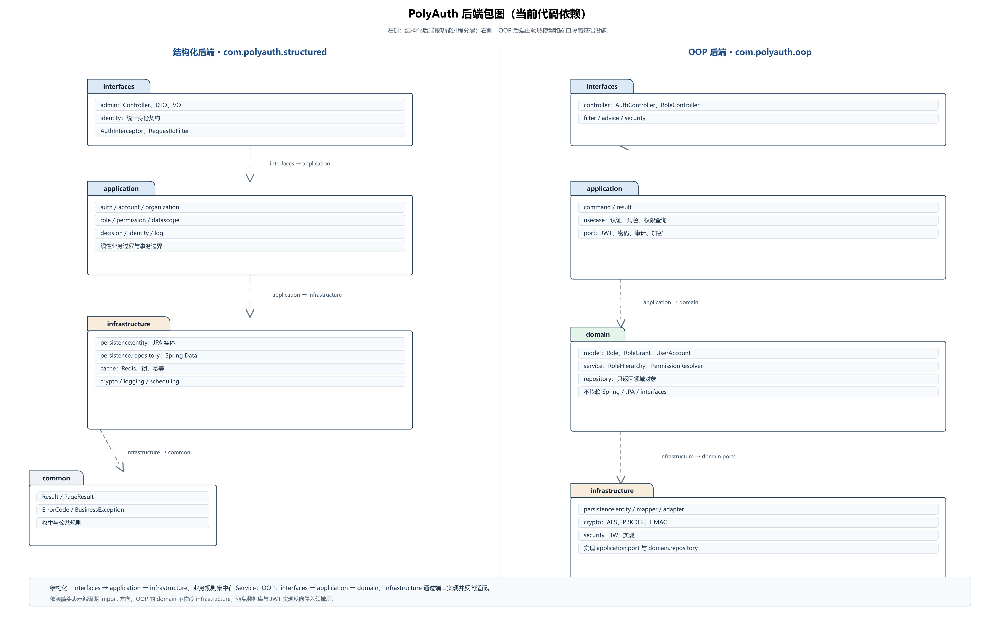

=== 9.2 结构化后端类图

认证图以 `AuthService` 为几何中心和视觉中心；控制器、拦截器、加密组件、日志组件与两个仓储分布在四周。对象字段对应实线空心箭头关联，箭头旁标注实际 `role name`。

.AuthService 认证核心类图
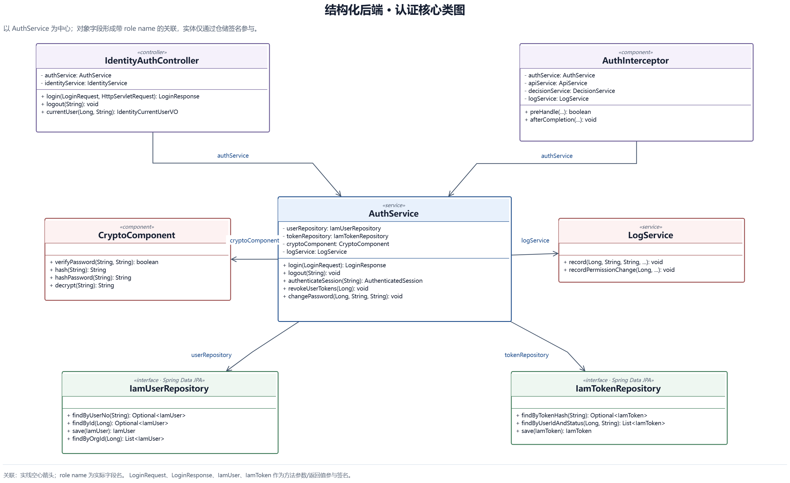

权限决策图以 `DecisionService` 为中心。调用方位于上侧和左右两侧，四个 Repository 位于下侧；判定线不会穿过任何非端点类框。

.DecisionService 权限决策类图
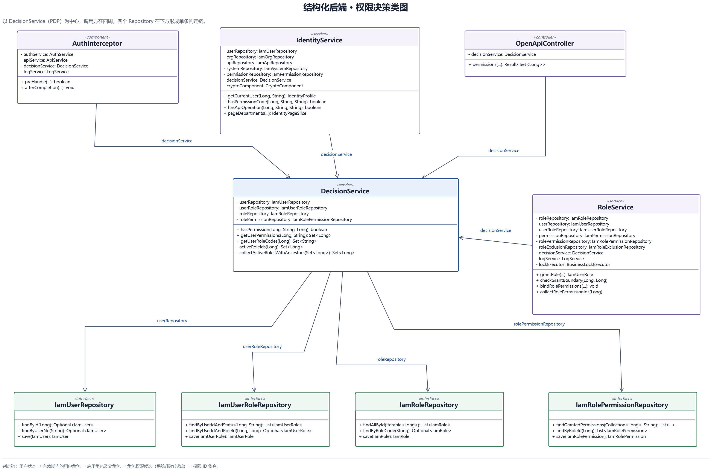

=== 9.3 面向对象后端类图

认证类图以 `AuthenticationUseCase` 为中心，应用层字段类型均为业务端口；JWT、JPA、密码哈希、姓名加密等具体实现不反向进入用例层。

.AuthenticationUseCase 认证用例类图
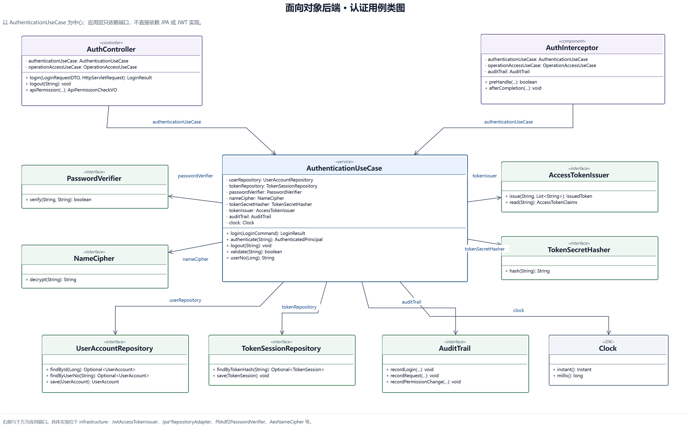

权限类图以 `PermissionAccessUseCase` 为中心。仓储只提供授权事实，`PermissionResolver` 与 `RoleHierarchy` 负责静态纯计算，体现“数据读取”和“规则计算”分离。

.PermissionAccessUseCase 权限查询类图
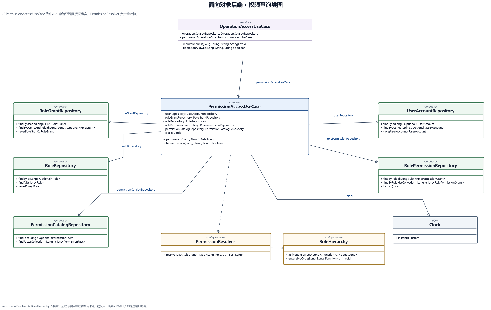

=== 9.4 结构化后端顺序图

登录图使用 `alt` 区分成功登录和密码校验失败。同步调用编号；返回值、异常与 401 响应使用虚线空心箭头且不编号。异常直接从仍处于激活状态的 `AuthService` 执行条返回控制器执行条。

.结构化后端登录成功与凭证失败
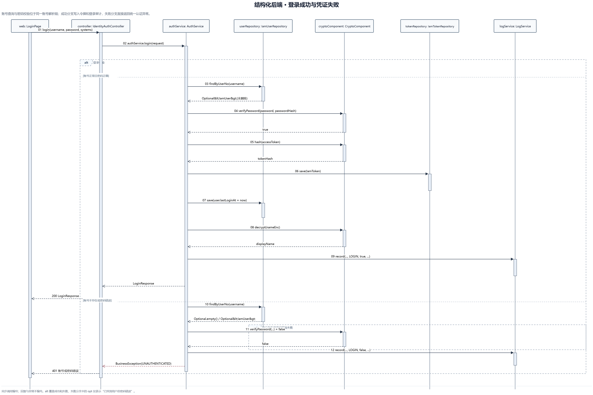

管理端鉴权图先完成令牌认证和 API 映射查询，再进入默认拒绝的 `alt`。成功分支包含用户状态、有效授权、父角色循环和权限候选过滤；失败分支从 `AuthInterceptor` 的活动执行条直接抛出 403 语义异常。

.结构化后端管理端默认拒绝鉴权
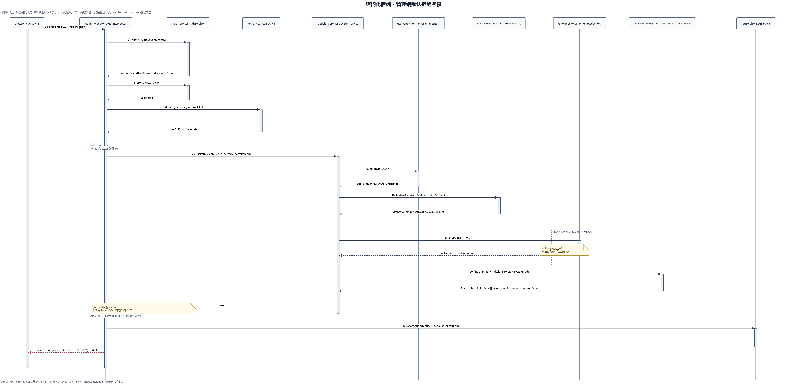

角色权限授予图的 `loop` 完整框住逐项查询权限和保存绑定的两个独立执行条；循环前的角色/已有绑定查询、循环后的快照读取和审计记录均留在框外。

.结构化后端角色前端权限授予
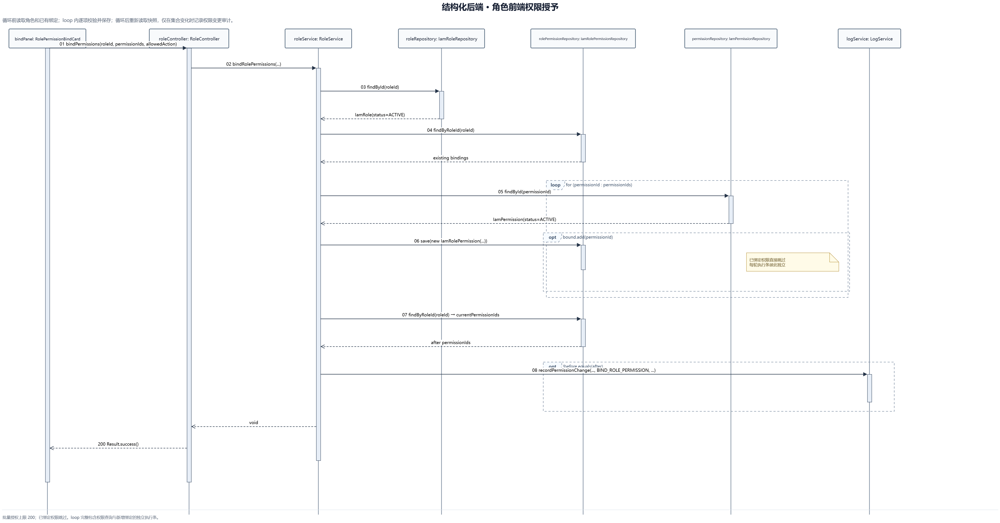

=== 9.5 面向对象后端顺序图

权限查询主图展示 `AuthController → OperationAccessUseCase → OperationCatalogRepository → PermissionAccessUseCase` 的依赖方向，并进入 `PermissionResolver` 与 `RoleHierarchy`。为避免十一个 lifeline 被压进一张超宽图，仓储读取与静态计算细部单独成图。

.面向对象后端按 operationId 查询权限
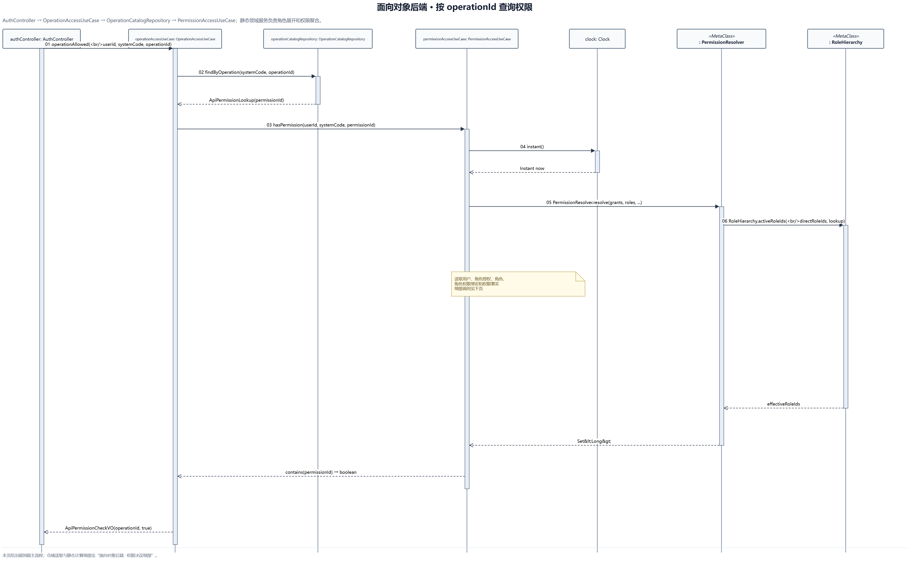

.面向对象后端权限决议细部
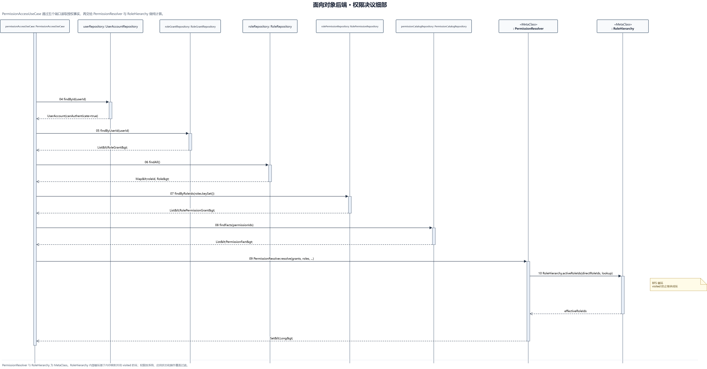

=== 9.6 API 与 GRASP 原则对照

教师随机抽取 API 时，可按下列映射回答。每项都以当前 OOP 代码为依据，不把结构化后端的 Service 过程描述成领域对象行为。

[cols="2,2,4"]
|===
| API / 组件 | GRASP 原则 | 代码证据

| `GET /auth/api-permissions/{operationId}` | 控制器、间接 | `AuthController` 只接收 HTTP 请求；`OperationAccessUseCase` 读取 operationId 映射并转交 `PermissionAccessUseCase`，控制器不计算权限

| `PermissionAccessUseCase.hasPermission(...)` | 低耦合、受保护变化 | 用例只依赖 `RoleGrantRepository`、`RoleRepository`、`UserAccountRepository` 等领域端口；JPA 和 JWT 实现通过 infrastructure 适配

| `UserAccount.canAuthenticate()` | 信息专家 | 账号状态由 `UserAccount` 自己判断，调用方不读取字段后重复拼装状态规则

| `RoleGrant.isEffective(now)` | 信息专家 | 授权有效期由授权对象自己维护，应用用例只注入当前时间

| `RoleHierarchy.activeRoleIds(...)` | 纯虚构、高内聚 | 角色继承展开是无副作用的领域服务，不需要持久化对象承担继承算法

| `PermissionResolver.resolve(...)` | 纯虚构、低耦合 | 权限过滤与去重只处理已读取事实，不访问 Repository、事务或日志

| `JpaRoleRepositoryAdapter` 等适配器 | 受保护变化、间接 | 领域仓储端口隔离数据库技术；替换 JPA 实现不改变 application 和 domain 的签名
|===

=== 9.7 JavaEE 技术实现映射

[cols="2,3,3"]
|===
| 技术 | 使用位置 | 可演示能力

| Java 17 | Maven 编译版本、record、sealed 以外的基础语言特性 | `maven.compiler.release=17`

| Spring Boot 3.4.5 | 两个后端 `*Application` 与自动装配 | 独立启动、Actuator 健康检查、配置绑定

| Spring MVC | `interfaces.*Controller`、拦截器、过滤器和全局异常处理 | REST API、统一响应、请求追踪、默认拒绝

| Spring AOP | `LayerLoggingAspect` | API、应用、基础设施分层日志

| Bean Validation | 请求 DTO、Controller 参数 | `@Valid`、`@Positive`、`@Min`、`@Max`、`@Size`

| Spring Data JPA / Hibernate | Structured Repository；OOP infrastructure adapter | 分页、乐观锁、实体映射和事务持久化

| MySQL 8 | `db/schema.sql`、`db/seed.sql` | 唯一索引、外键、检查约束、只追加日志触发器

| Druid | 两个后端的数据源配置 | 连接池参数与监控关闭策略

| Redis / Lettuce | `PermissionCacheComponent`、`BusinessLockExecutor`、幂等和防重放 | 版本号缓存、分布式锁、nonce 与请求结果缓存

| JJWT | `AuthService`、`JwtAccessTokenIssuer` | JWT 签发、签名校验、过期与吊销

| Jackson | Spring MVC 与 JWT 序列化 | JSON 契约、ISO 时间与统一字段命名

| Lombok | 构造器、DTO、VO | 消除样板 getter/setter/构造器

| CloneFactory | Structured DTO/VO 同名字段映射 | 编译期生成映射并有人工往返测试

| JUnit 5 / MockMvc / AssertJ / Mockito | 两个后端测试 | 领域规则、Service 行为、HTTP 契约

| JaCoCo | 两个后端 Maven 构建 | 测试覆盖率报告

| Maven | 根聚合、三模块构建 | 模块隔离、依赖解析和完整回归
|===

== 附录 A RBAC0 需求追踪

[cols="1,1,2,2,2"]
|===
| 需求 | 模块 | 实现 | 接口 | 数据表

| FR-01 账号建立 | M02 | `AccountService.createUser` | `POST /users` | `iam_user`

| FR-02 状态管理 | M02 | `AccountService.changeStatus` | `PUT /users/{userId}/status` | `iam_user`

| FR-05 离职封存 | M02、M01、M07 | `changeStatus` → `revokeUserTokens`、`revokeAllRoles` | `PUT /users/{userId}/status` | `iam_user`、`iam_token`、`iam_user_role`

| FR-12 角色定义 | M04 | `RoleService.createRole / getRole / listRoles` | `POST /roles`、`GET /roles`、`GET /roles/{roleId}` | `iam_role`

| FR-17～FR-19 权限与 API 映射 | M05 | `SystemService`、`PermissionService`、`ApiService` | `POST /systems`、`POST /permissions`、`POST /apis`、`POST /permissions/{permissionId}/apis/{apiId}` | `iam_system`、`iam_permission`、`iam_api`

| FR-27 授权 | M05、M07 | `RoleService.bindRolePermissions`、`RoleService.grantRole` | `POST /roles/{roleId}/permissions`、`POST /roles/{roleId}/assignments` | `iam_role_permission`、`iam_user_role`

| FR-28 回收 | M05、M07 | `RoleService.unbindRolePermissions`、`RoleService.revokeRole` | `DELETE /roles/{roleId}/permissions`、`DELETE /roles/{roleId}/assignments/{userId}` | 同上

| FR-31、FR-32 登录与令牌 | M01 | `AuthService.login / logout / validateToken` | `POST /auth/login`、`POST /auth/logout`、`GET /auth/validate` | `iam_user`、`iam_token`

| FR-33、FR-39 鉴权与权限查询 | M08 | `DecisionService`、`IdentityService` | `GET /auth/me`、`GET /auth/permissions/{permission}`、`GET /auth/api-permissions/{operationId}` | 只读

| FR-37 后端 API 鉴权 | M01、M08 | `AuthInterceptor` | 全部管理接口（登录除外） | `iam_token`、`iam_api`、`iam_permission` 等

| FR-08、FR-09 组织树 | M03 | `OrganizationService` | `GET/POST /organizations`、`GET /organizations/{orgId}`、`GET /organizations/{orgId}/children`、`PUT /organizations/{orgId}/parent`、`PUT /organizations/{orgId}` | `iam_org`

| FR-48、FR-49 加密与脱敏 | M11、M02 | `CryptoComponent`、`AccountService.toView` | 用户相关接口 | `iam_user`
|===

== 附录 B 图源

数据流图与模块结构图由 `design/diagram-src/` 下的脚本生成，修改后在该目录执行：

[source,bash]
----
python3 dfd1.py ../dfd_1级.svg && ./render.sh ../dfd_1级.svg ../数据流图_1级图.png
----

其余图分别对应 `dfd0.py`、`dfd2_p2.py`、`dfd2_p3.py`、`structure.py`。`render.sh` 用本机 Chrome 按 2 倍分辨率导出 PNG。

类图与顺序图的 Draw.io 多页源文件由自包含的 `build_drawio_uml.py` 生成。类图记录已校核的类、成员和关联定义；顺序图按当前 Java 调用链重新建模：

[source,bash]
----
cd design/diagram-src
python build_drawio_uml.py
----

脚本输出 `../RBAC_UML.drawio`，生成前检查类框重叠、连线穿框、类成员宽度、lifeline 框重叠，以及同步/回复箭头与 execution specification 的连接位置。随后在 Draw.io 内置编辑器中通过 Draw.io MCP 按页导出 SVG 与 PNG；图源中同一个 MCP 文档共包含 9 页。

双后端包图由 `package_diagram.py` 生成，输出 `../包图_双后端.svg` 和 `../包图_双后端.png`：

[source,bash]
----
cd design/diagram-src
python package_diagram.py
----

文档结束。
